<p align="center">
  <picture>
    <source media="(prefers-color-scheme: dark)" srcset="docs/readme/banner.dark.png">
    
  </picture>
</p>

<p align="center">
  Работодатель находит кандидата по категории, которую дал тест, видит, почему тот стоит на своём
  месте, и сам приглашает его с вилкой зарплаты. Кандидат получает категорию за умение, а не за слова
  в резюме.
</p>

<p align="center">
  <!-- readme:buttons -->
  <a href="http://lct-fsp.goatwhistle.ru"><picture><source media="(prefers-color-scheme: dark)" srcset="docs/readme/cta-live.dark.png"></picture></a>
  <a href="#запуск"><picture><source media="(prefers-color-scheme: dark)" srcset="docs/readme/cta-run.dark.png">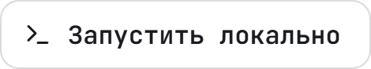</picture></a>
  <br>
  <a href="docs/for-jury.md"><picture><source media="(prefers-color-scheme: dark)" srcset="docs/readme/cta-jury.dark.png">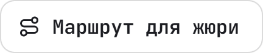</picture></a>
  <a href="docs/README.md"><picture><source media="(prefers-color-scheme: dark)" srcset="docs/readme/cta-docs.dark.png">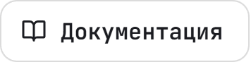</picture></a>
  <!-- /readme:buttons -->
</p>

<p align="center">
  <!-- readme:status -->
  <a href="#результаты"><picture><source media="(prefers-color-scheme: dark)" srcset="docs/readme/badge-status-1.dark.png"></picture></a>
  <a href="#устройство"><picture><source media="(prefers-color-scheme: dark)" srcset="docs/readme/badge-status-2.dark.png">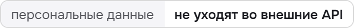</picture></a>
  <br>
  <a href="docs/fsp-integration.md"><picture><source media="(prefers-color-scheme: dark)" srcset="docs/readme/badge-status-3.dark.png">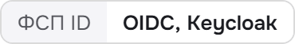</picture></a>
  <a href="LICENSE"><picture><source media="(prefers-color-scheme: dark)" srcset="docs/readme/badge-status-4.dark.png">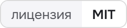</picture></a>
  <!-- /readme:status -->
  <br>
  <!-- readme:stack -->
  <picture><source media="(prefers-color-scheme: dark)" srcset="docs/readme/badge-stack-1.dark.png"></picture>
  <picture><source media="(prefers-color-scheme: dark)" srcset="docs/readme/badge-stack-2.dark.png">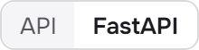</picture>
  <picture><source media="(prefers-color-scheme: dark)" srcset="docs/readme/badge-stack-3.dark.png">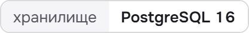</picture>
  <br>
  <picture><source media="(prefers-color-scheme: dark)" srcset="docs/readme/badge-stack-4.dark.png">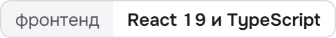</picture>
  <picture><source media="(prefers-color-scheme: dark)" srcset="docs/readme/badge-stack-5.dark.png">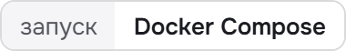</picture>
  <!-- /readme:stack -->
</p>

<p align="center">
  <!-- readme:nav -->
  <a href="#зачем-это"><picture><source media="(prefers-color-scheme: dark)" srcset="docs/readme/badge-nav-1.dark.png"></picture></a>
  <a href="#как-это-работает"><picture><source media="(prefers-color-scheme: dark)" srcset="docs/readme/badge-nav-2.dark.png"></picture></a>
  <a href="#попробовать-за-пять-минут"><picture><source media="(prefers-color-scheme: dark)" srcset="docs/readme/badge-nav-3.dark.png"></picture></a>
  <br>
  <a href="#результаты"><picture><source media="(prefers-color-scheme: dark)" srcset="docs/readme/badge-nav-4.dark.png"></picture></a>
  <a href="#запуск"><picture><source media="(prefers-color-scheme: dark)" srcset="docs/readme/badge-nav-5.dark.png">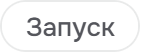</picture></a>
  <a href="#устройство"><picture><source media="(prefers-color-scheme: dark)" srcset="docs/readme/badge-nav-6.dark.png"></picture></a>
  <a href="#ограничения"><picture><source media="(prefers-color-scheme: dark)" srcset="docs/readme/badge-nav-7.dark.png"></picture></a>
  <!-- /readme:nav -->
</p>

> **Резюме не поднимает кандидата выше теста.** Категорию, то есть специализацию и грейд, присваивает
> только адаптивный тест. Самоописанный стек добавляет к соответствию не больше 0,1 из 1, как бы
> кандидат ни переписал резюме. Кандидат с неподтверждённым грейдом всегда стоит ниже подтверждённых.

## Зачем это

Резюме фиксирует стек и места работы, но не подтверждает умение. Отбор сводится к совпадению слов,
и выигрывает тот, кто лучше переписал резюме под вакансию: в синтетической заявке на стенде
валидации кандидат завышает свой грейд в **0,304** случаев. Общий тест не спасает, потому что один
слитый ответ подходит всем, а задания от нейросети у каждого своей трудности.

calibr переворачивает схему. Кандидат проходит опрос, сам выбирает грейд и сдаёт адаптивный тест.
Тест выдаёт **уровень с погрешностью по каждой теме** на общей шкале: задания у всех свои, результаты
сравнимы. Работодатель описывает потребность, получает подборку с объяснением каждого места и
вероятностью принятия и **сам** выходит на контакт с вилкой «от и до». Контакты кандидата закрыты,
пока он не примет приглашение.

Название от калибровки: тест калибрует уровень кандидата, подборка опирается на откалиброванные
вероятности, сложность заданий калибруется по ответам.

## Как это работает

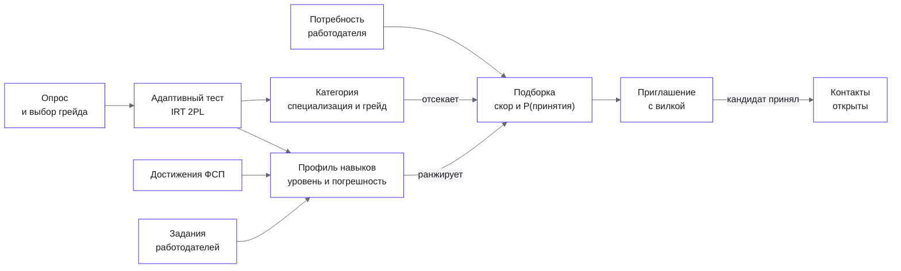

<table>
<tr>
<td valign="top" width="33%">

**Категорию даёт только тест**

Задание это семейство: шаблон, параметры и эталон, который вычисляет код, поэтому у каждого свой
экземпляр. Грейд присваивается, когда P(уровень ≥ порога грейда) ≥ 0,8. Не хватило уверенности, и
тест сразу предлагает грейд ниже, без новых заданий.

<sub>M9 и M10 в <a href="docs/validation-report.md">отчёте валидации</a>, шаги 2–4 <a href="docs/for-jury.md">маршрута</a></sub>

</td>
<td valign="top" width="33%">

**Сигнал весит по цене подделки**

Профиль навыков сводит сигналы в одну модель с весом уровня доверия: ФСП 1,0, адаптивный тест 0,7,
задания работодателей 0,4. Самоописание в уровень не входит, только стек отдельным слагаемым с
потолком. Кандидат без истории ФСП ничего не теряет.

<sub><a href="docs/mechanics.md#11-профиль-навыков-и-уровни-доверия">Механики, §11</a>, шаги 5–6 маршрута</sub>

</td>
<td valign="top" width="33%">

**Объяснение и есть скор**

Соответствие это сумма вкладов тем потребности и стека. Объяснение показывает те же слагаемые:
сумма вкладов равна скору, обнуление фактора уменьшает скор ровно на его вклад. Объяснение не
расходится с порядком выдачи.

<sub><a href="docs/mechanics.md#12-подбор">Механики, §12</a>, шаг 9 маршрута</sub>

</td>
</tr>
</table>

## Попробовать за пять минут

На [стенде](http://lct-fsp.goatwhistle.ru) или после [запуска](#запуск). Пароль демо-учёток
`demo-2026`, участников ФСП ID `fsp-demo-2026`. В режиме жюри (`DEMO_MODE=true`) на странице входа
есть «Войти как работодатель» и «Новый тестовый кандидат» с экспресс-тестом.

| | Что сделать | Что увидите |
|---|---|---|
| 1 | «Новый тестовый кандидат» → опрос → грейд → тест | Задания по одному, на финише уровень с погрешностью, вероятность каждого грейда и категория |
| 2 | Заявить грейд выше своего уровня | Уверенности не хватило: тест предлагает грейд ниже без новых заданий |
| 3 | «Войти через ФСП ID» → `fsp-winner` | Достижения в профиле, темы с пометкой «подтверждено ФСП», грейд прежний |
| 4 | `employer@demo.example` → «Потребности» → «Сформировать подборку» | Блоки выдачи, соответствие, вероятность принятия и разбор по темам |
| 5 | «Пригласить» без вилки | Приглашение не отправляется: вилка «от и до» обязательна |
| 6 | Принять приглашение кандидатом | Работодателю открываются имя, контакты и переписка |

Полный маршрут, что доказывает каждый шаг и где ответ на каждый критерий оценки, в
[маршруте для жюри](docs/for-jury.md).

## Результаты

Готовых данных о настоящем уровне кандидатов нет, поэтому стенд валидации сам порождает рынок со
**скрытой истиной**: настоящие уровни лежат отдельно от признаков, и код оценки их не читает. D1 это
основной рынок, 3000 кандидатов и 100 потребностей, D2 это генератор со сдвигом распределений.
[План валидации](docs/validation-plan.md) с метриками и порогами зафиксирован до первого прогона.

| Метрика | calibr, D1 | calibr, D2 | База, D1 | Порог |
|---|---|---|---|---|
| M10. Завышение грейда против истины | **0,018** | 0,067 | 0,137 наивный тест, 0,304 заявка кандидата | ≤ 0,05 |
| M9. Тот же грейд при повторе, каппа Коэна | **0,627** | **0,584** | 0,566 наивный тест | ≥ 0,55 |
| M11. Семейства, разделяющие слабых и сильных | **1,000** | **1,000** | | ≥ 0,90 |
| M4. Калибровка вероятностей по темам, ECE | **0,020** | **0,036** | | ≤ 0,05 |
| M7. Модель принятия, ROC-AUC | **0,908** | **0,906** | 0,853 логистическая регрессия | ≥ 0,75 |
| M1. Доля релевантных в топ-10 | **0,900** | **0,812** | 0,958 наивный тест | ≥ 0,70 |

**Где проигрываем.** Наивный тест обходит нашу выдачу по доле релевантных в топ-10: 0,958 против
0,900 на D1. Правило уверенности осторожно и занижает грейд у 0,394 честных кандидатов у нижней
границы полосы, они уходят в «близкие». Это та же цена, что дала завышение почти в восемь раз ниже
наивного теста. Остальные невыполненные метрики разобраны в [отчёте](docs/validation-report.md) и в
[ограничениях](#ограничения).

<details>
<summary><b>Пересчитать все числа раздела</b></summary>
<br>

```bash
cd backend && uv run --group validation python -m validation
```

Полный прогон идёт в пуле процессов десятки минут, без сети и платных ключей: ответы
LLM-ранжировщика берутся из кэша в репо. Отчёт пишется в `docs/validation-report.md`, тот же прогон
даёт тот же файл байт в байт.

</details>

## Запуск

```bash
docker compose up --build
docker compose exec backend python seed_demo.py
```

| Что | Адрес |
|---|---|
| Интерфейс | http://localhost:3000 |
| Swagger, OpenAPI | http://localhost:8000/api/docs |
| Mailpit, письма подтверждения | http://localhost:8025 |
| Keycloak, изображает ФСП ID (`admin` / `admin`) | http://localhost:8080 |

Засев идёт через те же сценарии, что HTTP, повторный запуск ничего не дублирует. Основной сценарий
работает без сети и без ключей. Порты, ключи и адрес ФСП ID меняются в `.env` по образцу
[`.env.example`](.env.example).

<details>
<summary><b>Разработка, проверки, переменные</b></summary>
<br>

```bash
docker compose up -d db
cd backend && uv sync && uv run uvicorn --factory main:create_app --reload
cd frontend && npm install --silent && npm run dev
```

Тесты бэкенда трёх уровней, правила интерфейса, юнит-тесты и e2e фронтенда, стенд валидации,
переменные окружения и демо-учётки описаны в [запуске и проверках](docs/running.md).

</details>

## Устройство

Бэкенд на FastAPI разложен по слоям `domain`, `usecase`, `controller`, `adapter` и `repository`.
Механики это чистые функции, а всё заменяемое стоит за портами: переход на настоящий ФСП ID и
реестр это смена адреса и ключей, сценарии не меняются. Языковая модель не ставит оценок и не
ранжирует, в сдаче она локальная, и персональные данные не уходят во внешние API.

| Документ | Что внутри |
|---|---|
| [Механики](docs/mechanics.md) | Тест, категория, профиль навыков, подбор, рынок: формулы и почему так |
| [Параметры](docs/parameters.md) | Каждое число механик под именем из конфига |
| [Архитектура](docs/architecture.md) | Функциональная и компонентная схема, слои и порты, данные |
| [Интеграция с ФСП](docs/fsp-integration.md) | ФСП ID через OIDC, реестр достижений, что меняется при переходе на настоящий |
| [API](docs/api.md) | Разделы, вход, ошибки, права; [OpenAPI](docs/openapi.json) из кода |
| [Модель угроз](docs/threat-model.md) | Как накручивают подбор и тест, защита и эксперимент на каждую угрозу |
| [За рамками MVP](docs/beyond-mvp.md) | Защита от недобросовестных работодателей и интеграция с ATS |
| [Зависимости](docs/dependencies.md) | Библиотеки и компоненты с версиями и лицензиями |
| [Оглавление](docs/README.md) | Все страницы и где в них ответ на каждый пункт ТЗ |

## Ограничения

- **Защита от слитого банка помогает, но цель стенда не взята.** Если слить 30 % банка, грейд выше
  честного двойника получают на 0,165 больше читеров против 0,44 у общего теста; цель 0,10.
  Проверочный блок у честных кандидатов почти не срабатывает (M17 выполнена). Разбор в
  [отчёте, M14–M16](docs/validation-report.md#m14-атака-утечкой).
- **Наивный тест выше по топ-10.** Цена осторожной категории, см. [результаты](#результаты). nDCG@10
  на D2 ниже порога по той же причине.
- **Адаптивность почти не обгоняет бланк.** M13: тест останавливается за 0,87–1,23 от длины
  фиксированного бланка при пороге 0,75. На грейд темы в банке 2–5 семейств, выбирать самые
  информативные почти не из чего. Банк, 402 семейства по 31 теме, растёт данными.
- **Вся проверка на синтетике.** Ручной разметки пар (M20) нет, пилота нет, часть базовых линий ещё не прогнана.
- **ФСП ID и реестр это заглушки.** Keycloak с синтетическими участниками и JSON достижений; переход
  на настоящий ФСП ID это смена адреса и ключей в `.env`, реестр это новый адаптер за готовым портом.

### Что проверено и где границы

Проверка идёт на синтетическом стенде, на реальных людях механика не проверялась. Пилот не
проводился, есть только материалы к нему: [docs/pilot](docs/pilot/README.md). Числа ниже взяты из
[отчёта валидации](docs/validation-report.md) и [журнала экспериментов](docs/validation-experiments.md).

- **Завышение грейда честных.** 0,018 на D1 и 0,067 на D2, порог 0,05 на D2 не выполнен; на
  отложенных наборах D9 и D10 0,021 и 0,068. Занижение у честных около 0,39–0,44: кандидат у нижней
  границы полосы получает грейд ниже.
- **Подбор.** P@10 нашей выдачи 0,900 на D1 и 0,812 на D2 против 0,958 у наивного теста. Базовые линии
  B1 и B2 (BM25 и эмбеддинги) дают 0,44–0,48. B3 (LLM-ранжировщик) не прогонялся: платный запуск не
  согласован, сравнение «ожидает данных».
- **Защита от накрутки затрудняет её и ограничивает вклад, но не исключает.** Самоописание и резюме
  дают вклад не выше потолка, категорию определяет только тест, ФСП грейд не меняет. При утечке банка
  прирост уровня у читера 0,37 на D1 и 0,24 на D2, цель не взята. Детектор утечки находит 0,07–0,14
  слитых семейств. LLM-помощник помечен в 0,164 попыток с завышением при пороге 0,70.
  Обнаружение подозрительной попытки работает частично, предотвращение завышения не доказано.
- **Профиль навыков и вероятность принятия** проверены на синтетике и не называются доказанной
  точностью для реальных людей.

<!-- scrub:start -->
## Для команды

Этот блок вырезается при сдаче вместе с маркерами.

Презентация защиты лежит в `presentation/`: один офлайн HTML, речь в `presentation/SPEECH.md`.

```bash
cd presentation && npm install --silent
npm run tokens
npm run dev
npm run build:final && npm run pdf
npm run readme
```

`npm run tokens` переносит токены и шрифты продукта в деку, `npm run dev` открывает деку на
http://localhost:4173, `S` открывает окно докладчика. `npm run readme` пересобирает баннер, кнопки и
бейджи этого README из `presentation/readme/` в светлой и тёмной теме.
<!-- scrub:end -->

<p align="center">
  <picture><source media="(prefers-color-scheme: dark)" srcset="docs/readme/mark.dark.png"></picture>
  <br>
  <sub>Команда GoatWhistle, спецтрек ФСП хакатона «Лидеры цифровой трансформации», 2026.</sub>
</p>
