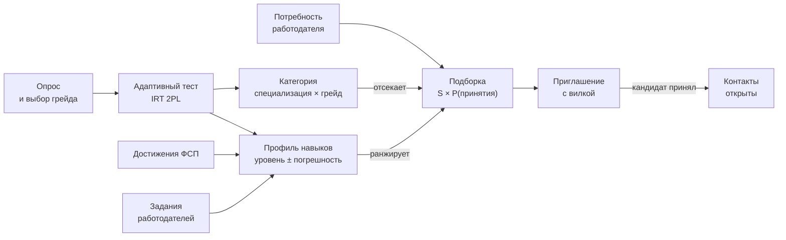

<p align="center">
  <picture>
    <source media="(prefers-color-scheme: dark)" srcset="docs/brand/wordmark-dark.svg"/>
    
  </picture>
</p>

<p align="center">
  <b>Подбор ИТ-специалистов, который нельзя накрутить.</b><br/>
  Категорию кандидата определяет адаптивный тест, а не резюме. Работодатель сам находит категорию,<br/>
  видит, почему кандидат стоит на своём месте, и приглашает его с вилкой зарплаты.
</p>

<p align="center">
  <a href="#запуск"></a>
  <a href="docs/README.md"></a>
  <a href="docs/for-jury.md"></a>
</p>

<p align="center">
  <a href="#идея"></a>
  <a href="#три-решения"></a>
  <a href="#как-это-работает"></a>
  <a href="#посмотреть-за-десять-минут"></a>
  <a href="#что-измерено"></a>
  <a href="#запуск"></a>
  <a href="#документация"></a>
  <a href="#ограничения"></a>
</p>

<p align="center">
  
  
  
  
  
  
  
</p>

> **Резюме не поднимает кандидата выше теста.** Категория — специализация × грейд — присваивается
> только адаптивным тестом. Самоописанный стек добавляет к соответствию не больше 0,1 из 1, как бы
> кандидат ни переписал резюме. Достижения ФСП весят больше всего, но категорию не меняют, поэтому
> кандидат без истории ФСП ничего не теряет на входе в выдачу.

---

## Идея

Резюме фиксирует стек и места работы, но не подтверждает умение. Поэтому отбор на площадках
сводится к совпадению ключевых слов, и выигрывает тот, кто лучше переписал резюме под вакансию.
Тест одинаковый для всех не спасает: задания и ответы расходятся за неделю. Задания, сгенерированные
нейросетью под каждого, не сопоставимы по сложности.

calibr переворачивает схему. Кандидат проходит опрос, сам выбирает грейд и сдаёт адаптивный тест.
Тест выдаёт не процент верных, а **уровень с погрешностью по каждой теме** на общей шкале: у каждого
свой набор заданий, но результаты сравнимы. Работодатель описывает потребность, получает подборку
из подтверждённой категории с объяснением каждого места и вероятностью, что кандидат примет
приглашение, — и **сам** выходит на контакт с вилкой зарплаты. Контакты кандидата закрыты, пока он
не примет приглашение.

Название — от калибровки: тест калибрует уровень кандидата, подборка опирается на откалиброванные
вероятности, задания калибруются по ответам.

## Три решения

<table>
<tr>
<td valign="top" width="33%">

**Категорию даёт только тест**

Грейд присваивается, когда модель уверена: P(уровень ≥ порога грейда) ≥ 0,8. Не хватило
уверенности — тест сразу предлагает грейд ниже и продолжает ту же оценку, без повторных
заданий. Вверх — не чаще раза в 90 дней, провал не сжигает попытку, вниз — без ожидания.

</td>
<td valign="top" width="33%">

**Сигнал весит по цене подделки**

Профиль навыков сводит все сигналы в одну модель IRT с весом уровня доверия: ФСП 1,0 →
адаптивный тест 0,7 → задания работодателей 0,4. Самоописание в уровень не входит вовсе —
только стек, отдельным слагаемым с потолком. Своё резюме кандидат накрутить может, финал ФСП — нет.

</td>
<td valign="top" width="33%">

**Объяснение — это и есть скор**

Соответствие — сумма вкладов тем потребности и стека. Объяснение показывает эти же слагаемые,
сумма вкладов равна скору, а обнуление фактора уменьшает скор ровно на его вклад. Объяснение не
пишется задним числом и не может разойтись с порядком выдачи.

</td>
</tr>
</table>

## Как это работает



**Тест.** Задания — не фиксированный набор, а **семейства**: шаблон, генератор параметров и эталон,
который вычисляется кодом. У каждого кандидата свой экземпляр из своего seed, поэтому утёкший ответ
не подходит к чужому заданию. Следующее задание выбирается по максимуму информации при текущей
оценке, случайно из двух лучших и с потолком показов. Тест останавливается, когда погрешность
общего уровня падает до 0,40: медиана около 20 заданий, у сильного и слабого одна точность на
финише. Сложность семейств уточняется по ответам — шаг Эло после каждого ответа, пакетная
переоценка от 200 ответов, якорные семейства держат шкалу, проверка согласия выводит семейства,
которые ведут себя не по модели.

**Подбор.** Категория отсекает: сначала точный грейд потребности, затем «близкие» соседнего грейда,
внизу — заявившие грейд без подтверждения тестом, и они никогда не стоят выше подтверждённых.
Внутри блока порядок — по соответствию, умноженному на вероятность принятия:

$$S = (1 - \lambda)\sum_t v_t\,P(\theta_t \ge \mathrm{req}_t) + \lambda\,o, \qquad \lambda = 0{,}10$$

$v_t$ — вес темы по важности для потребности, $P(\theta_t \ge \mathrm{req}_t)$ — вероятность, что
уровень по теме не ниже порога грейда, $o$ — доля стека потребности в самоописании. P(принятия)
считает CatBoost по вилке, ожиданиям, формату, городу и загрузке кандидата приглашениями —
с монотонными ограничениями: выше вилка — вероятность не ниже.

**Выход на контакт.** Работодатель видит обезличенную карточку — без ФИО, контактов, свободного
текста и ожидаемой зарплаты. Приглашение обязательно несёт вилку «от–до» в рублях, бюджет — 20
приглашений в неделю на компанию, срок ответа — 7 дней. Принятое приглашение открывает контакты
и переписку; кандидат может отозвать доступ. Отклик на вакансию — дополнительный сценарий, он
открывает карточку сразу и бюджет не тратит.

Формулы и обоснование каждого числа — в [механиках](docs/mechanics.md), устройство кода — в
[архитектуре](docs/architecture.md).

## Посмотреть за десять минут

После [запуска](#запуск) и засева демо-данных. Пароль демо-учёток — `demo-2026`, участников ФСП ID —
`fsp-demo-2026`.

| Шаг | Что сделать | Что увидите |
|---|---|---|
| 1 | http://localhost:3000 → «Регистрация» → роль «Кандидат» → письмо в [Mailpit](http://localhost:8025) | Вход закрыт, пока адрес не подтверждён |
| 2 | Опрос → направление → грейд → тест | Задания одно за другим, «задание N, не больше 30»; на финише — уровень с погрешностью, вероятность каждого грейда и категория |
| 3 | «Войти через ФСП ID» → `fsp-winner` | Достижения ФСП в профиле: тип результата, дисциплина, год; темы с пометкой «подтверждено ФСП» |
| 4 | Войти как `employer@demo.example` → «Потребности» → «Описать словами» | Текст вакансии разбирается в форму, неуверенные поля подсвечены |
| 5 | «Сформировать подборку» | Блоки выдачи, у каждого кандидата соответствие, вероятность принятия и разбор по темам; «Как считается» |
| 6 | «Пригласить» → вилка → отправить | Бюджет приглашений уменьшился, статус «отправлено» |
| 7 | Войти как приглашённый кандидат → «Приглашения» → «Принять» | Работодатель видит ФИО и контакты, открыта переписка |
| 8 | «Скачать PDF» в профиле кандидата | Профиль единого вида на русском или английском |

Демо-учётки — 40 кандидатов во всех категориях, с ФСП и без, и два работодателя с потребностями.
Полный список и сценарий защиты с обоснованием каждого шага — в [маршруте для жюри](docs/for-jury.md).

## Что измерено

Готового датасета нет, поэтому стенд валидации сам порождает синтетический рынок со **скрытой
истиной**: настоящие уровни кандидатов лежат отдельно от признаков, и код оценки их не читает.
[План валидации](docs/validation-plan.md) — метрики, пороги и базовые линии — зафиксирован до
первого прогона и правится только записью в журнале. [Отчёт](docs/validation-report.md)
пересобирается одной командой байт в байт; отрицательный результат публикуется как есть.

D1 — основной рынок, 3000 кандидатов и 100 потребностей; D2 — генератор со сдвигом распределений.

| Метрика | Порог | D1 | D2 | Базовая линия, D1 |
|---|---|---|---|---|
| M9. Стабильность грейда при повторе, κ Коэна | ≥ 0,55 | **0,649** | **0,616** | 0,517 — наивный тест |
| M10. Завышение грейда против истины | ≤ 0,05 | **0,017** | 0,064 | 0,137 — наивный тест |
| M11. Семейства, разделяющие слабых и сильных | ≥ 0,90 | **1,000** | **1,000** | — |
| M1. Доля релевантных в топ-10 | ≥ 0,70 | **0,890** | **0,832** | 0,954 — наивный тест |
| M4. Калибровка вероятностей по темам, ECE | ≤ 0,05 | **0,024** | **0,038** | — |
| M7. Модель принятия, ROC-AUC | выше логрегрессии | **0,901** | **0,915** | 0,845 — логрегрессия |
| M21. Порченые семейства, пойманные проверкой согласия | ≥ 0,80 | **0,80** | — | — |

Тест завышает грейд в 8 раз реже наивного и в 18 раз реже, чем сам кандидат в заявке. Цена —
консервативность: правило уверенности занижает тех, кто у нижней границы полосы, и из-за этого
наивный тест B0 обходит нашу выдачу по доле релевантных в топ-10. Это и другие невыполненные
метрики разобраны в [ограничениях](#ограничения) и в самом отчёте.

```bash
cd backend && uv run --group validation python -m validation
```

## Запуск

Нужен Docker с Compose v2. Из корня репо:

```bash
docker compose up --build
docker compose exec backend python seed_demo.py
```

| Что | Адрес |
|---|---|
| Интерфейс | http://localhost:3000 |
| Swagger, OpenAPI | http://localhost:8000/api/docs |
| Mailpit — письма подтверждения | http://localhost:8025 |
| Keycloak, изображает ФСП ID (`admin` / `admin`) | http://localhost:8080 |

Засев идёт через те же сценарии, что HTTP, и повторный запуск ничего не дублирует. Стенд в покое
занимает около 0,8 ГБ памяти, из них Keycloak — 0,55 ГБ; вход по email работает и без него. Порты,
ключи и адрес ФСП ID меняются в `.env` по образцу [`.env.example`](.env.example). Пошагово, с
тестами, стендом валидации и разработкой, — в [запуске и проверках](docs/running.md).

## Документация

| Раздел | Что внутри |
|---|---|
| [Оглавление](docs/README.md) | Все страницы и где в них ответ на каждый пункт ТЗ |
| [Для жюри](docs/for-jury.md) | Маршрут по стенду и где ответ на каждый критерий оценки |
| [Механики](docs/mechanics.md) | Тест, категория, профиль навыков, подбор, рынок: формулы и почему так |
| [Архитектура](docs/architecture.md) | Функциональная и компонентная схема, слои и порты, данные |
| [Интеграция с ФСП](docs/fsp-integration.md) | ФСП ID через OIDC, реестр достижений, что меняется при переходе на настоящий |
| [API](docs/api.md) | Разделы, вход, ошибки, права; [OpenAPI](docs/openapi.json) |
| [Валидация](docs/validation-plan.md) | План до прогона и [отчёт](docs/validation-report.md) с вердиктом по каждой метрике |
| [Модель угроз](docs/threat-model.md) | Как накручивают подбор и тест, защита и эксперимент на каждую угрозу |
| [Запуск и проверки](docs/running.md) | Docker Compose, демо-данные, тесты, стенд валидации, разработка |
| [Зависимости](docs/dependencies.md) | Библиотеки и компоненты с версиями и лицензиями |
| [За рамками MVP](docs/beyond-mvp.md) | Концепция защиты от недобросовестных работодателей и интеграции с ATS |

## Ограничения

- **Защита теста от утечки описана, но включена не целиком.** Работают семейства с экземплярами
  из seed, адаптивный выбор, потолок показов, проверка согласия семейств и время ответа по часам
  сервера. Детектор дрейфа, флаги быстрого ответа, согласие попытки с моделью и проверочный блок
  описаны в [механиках, §8](docs/mechanics.md#8-защита-теста), параметры заведены в конфиг, но в
  сценарий теста не подключены. Метрики атаки утечкой M14–M17 поэтому ждут данных.
- **Наивный тест обходит нашу выдачу по топ-10.** На D1 доля релевантных 0,890 против 0,954 у B0,
  nDCG@10 на D2 ниже порога. Причина — консервативная категория: правило уверенности занижает
  около 39 % честных кандидатов у нижней границы полосы, и они уходят в «близкие». Это та же цена,
  что дала завышение в 8 раз ниже.
- **Адаптивность пока почти не выигрывает у бланка.** M13: тест останавливается за 0,87–1,17 от
  длины фиксированного бланка при пороге 0,75. На грейд темы в банке по 2–5 семейств, и выбирать
  самые информативные почти не из чего. Банк — 402 семейства по 31 теме — растёт данными.
- **Сценарных заданий у старших грейдов мало.** В части тем доля трассировки кода выше потолка
  0,25, а сценарных семейств для middle и senior меньше двух — [отчёт покрытия](docs/running.md#банк-заданий)
  это показывает.
- **Калибровка на 200 ответах не дотягивает до порога.** M12: RMSE сложности 0,20–0,27 на D1 при
  пороге 0,25 и 0,29–0,42 на D2. К 500 ответам ошибка падает до 0,17–0,35.
- **Вся проверка — на синтетике.** Ручной разметки пар (M20) нет, базовые линии BM25, эмбеддинги и
  LLM-ранжировщик ещё не прогнаны.
- **ФСП ID и реестр — заглушки.** Keycloak с синтетическими участниками и JSON достижений;
  переход на настоящий ФСП ID — смена адреса и ключей в `.env`, реестр — новый адаптер за готовым
  портом.

<p align="center">
  
</p>

<p align="center"><sub>Команда GoatWhistle, спецтрек ФСП хакатона «Лидеры цифровой трансформации», 2026.</sub></p>
