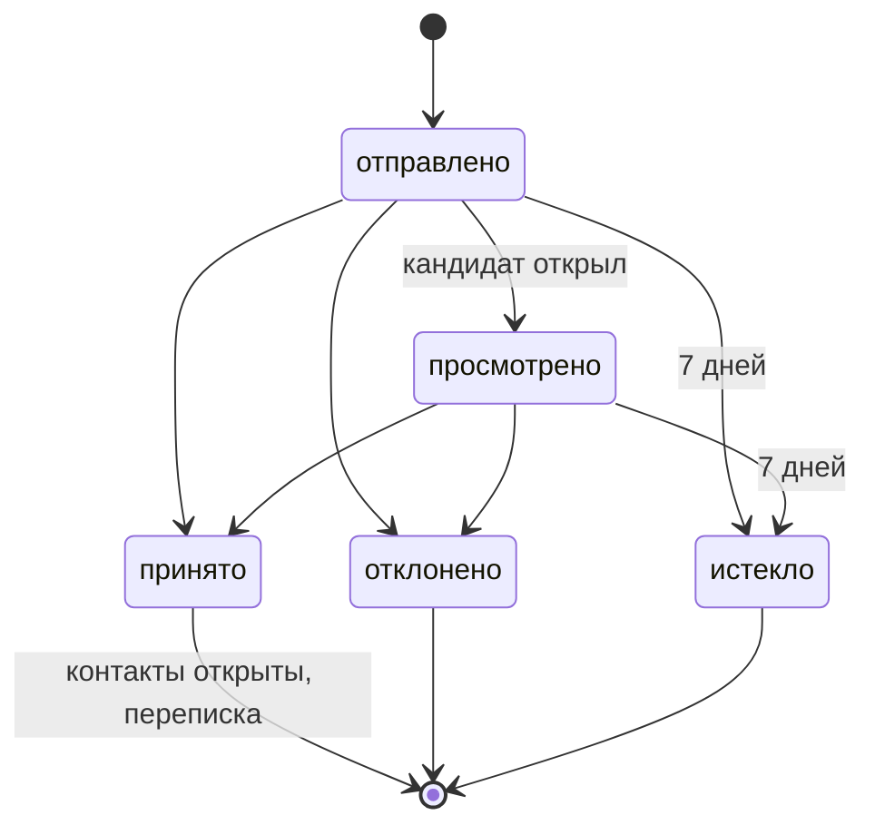

# API

HTTP API бэкенда: 83 метода под префиксом `/api`. Спецификация OpenAPI 3.1 генерируется из кода
FastAPI и руками не пишется: на запущенном стенде — Swagger на
http://localhost:8000/api/docs и JSON на http://localhost:8000/api/openapi.json, в репо —
выгрузка [openapi.json](openapi.json). У каждого метода в спецификации — описание, схемы запроса
и ответа и перечень кодов ошибок.

Выгрузка пересобирается из `backend/`:

```bash
uv run python -c "import json, main; json.dump(main.create_app().openapi(), open('../docs/openapi.json', 'w', encoding='utf-8'), ensure_ascii=False, indent=2)"
```

## Вход и права

| Что | Как |
|---|---|
| Регистрация | `POST /api/auth/register` с email, паролем и ролью; письмо со ссылкой подтверждения |
| Вход | `POST /api/auth/login` — сессия в httpOnly-cookie `access_token`, подписанный JWT; без подтверждённого адреса — 403 |
| ФСП ID | `POST /api/auth/fsp/authorize` → страница ФСП ID → `GET /api/auth/fsp/callback` → 303 во фронт; [интеграция с ФСП](fsp-integration.md) |
| Роли | `candidate` и `employer`; разделы `/api/candidate/*` и `/api/employer/*` отвечают 401 без входа и 403 чужой роли |
| Чужие записи | чужое приглашение, подборка или потребность — 404, как несуществующие |
| Данные кандидата | до принятия приглашения или отклика — обезличенная проекция на каждом методе, который их отдаёт |

## Ошибки

Тело ошибки одно на весь API:

```json
{
  "code": "grade_change_too_early",
  "message": "Попытка на этот грейд пока недоступна — грейд меняется не чаще установленного срока",
  "available_at": "2026-11-12T09:00:00Z"
}
```

`code` — машинный код для фронта, `message` — текст по-русски, `available_at` — только у ошибок
правила ожидания. Статус задаёт таблица `STATUS` в `backend/app/controller/errors.py`:

| Статус | Когда |
|---|---|
| 400 | ссылка подтверждения неверна или истекла, код ФСП ID не принят |
| 401 | нет входа, неверный пароль |
| 403 | чужая роль, адрес не подтверждён |
| 404 | записи нет или она чужая |
| 409 | действие недоступно в текущем состоянии: email занят, интервал смены грейда не прошёл, приглашение уже закрыто, бюджет недели исчерпан |
| 413 | файл резюме больше лимита |
| 422 | запрос не прошёл проверку схемы или правил: вилка «от» больше «до», значение не из справочника |
| 503 | ФСП ID или реестр ФСП не отвечают |

Все суммы — рубли в месяц до вычета НДФЛ; каждый ответ с деньгами несёт поле
`salary_basis: "gross"`.

## Разделы

### Учётка и ФСП ID

| Метод | Путь | Что делает |
|---|---|---|
| POST | `/api/auth/register` | регистрация по email и паролю |
| POST | `/api/auth/verify-email` | подтверждение адреса по токену из письма |
| POST | `/api/auth/resend-verification` | повторное письмо подтверждения |
| POST | `/api/auth/login`, `/api/auth/logout` | вход и выход |
| GET | `/api/auth/me` | текущий пользователь |
| POST | `/api/auth/fsp/authorize` | начать вход или привязку через ФСП ID |
| GET | `/api/auth/fsp/callback` | возврат из ФСП ID |
| GET, DELETE | `/api/candidate/fsp` | ФСП ID кандидата и достижения; отвязать |
| POST | `/api/candidate/fsp/refresh` | обновить достижения из реестра |

### Путь кандидата к категории

| Метод | Путь | Что делает |
|---|---|---|
| GET | `/api/candidate/path` | текущий шаг пути, итоги теста: уровень, погрешность, вероятности грейдов, категория |
| POST | `/api/candidate/path/survey` | опрос: специализация |
| POST | `/api/candidate/path/attempts` | начать тест на грейд; раньше срока — 409 с `available_at` |
| GET | `/api/candidate/path/item` | текущее задание: условие и варианты, без эталона |
| POST | `/api/candidate/path/item/answer` | ответ; время меряет сервер |
| POST | `/api/candidate/path/step-down` | перейти на грейд ниже без теста |
| POST | `/api/candidate/path/topic-block` | короткий блок по одной теме |
| GET | `/api/candidate/feedback/plan` | план развития на модели по темам подсказок; `null` без модели |
| GET | `/api/candidate/feedback` | обратная связь по подборкам: место, доля точного блока, что поднимет выше |

### Профиль кандидата

| Метод | Путь | Что делает |
|---|---|---|
| GET, PUT | `/api/candidate/profile` | анкета: ФИО, контакты, роли, стаж, стек, ожидания, видимость полей, карточка опыта |
| POST | `/api/candidate/profile/resume` | разобрать PDF резюме в черновик формы; ничего не сохраняет |
| GET | `/api/candidate/profile/grade-hint` | подсказка грейда по стажу и ролям |
| GET | `/api/candidate/profile/pdf?lang=ru\|en` | стандартизированный PDF-профиль |
| GET | `/api/candidate/cabinet` | сводка кабинета: непрочитанные сообщения |

### Подбор

| Метод | Путь | Что делает |
|---|---|---|
| GET, PUT | `/api/employer/company` | профиль компании |
| POST | `/api/employer/company/domain` | письмо со ссылкой на адрес домена сайта — метка доверия |
| POST | `/api/company-domain/confirm` | подтвердить домен по токену из письма; вход не нужен |
| GET, POST | `/api/employer/needs` | потребности компании; новая потребность |
| GET, PUT, DELETE | `/api/employer/needs/{need_id}` | потребность |
| POST | `/api/employer/needs/topic-importance` | важность тем по стеку до сохранения |
| POST | `/api/employer/needs/parse` | разобрать потребность из текста в черновик с уверенностью полей |
| POST | `/api/employer/needs/{need_id}/selections` | сформировать подборку по потребности |
| GET | `/api/employer/needs/{need_id}/test` | тест по вакансии: темы, задания по темам, пример экземпляра на тему |
| POST | `/api/employer/selections` | сформировать подборку по черновику без сохранения потребности |
| GET | `/api/employer/selections`, `/api/employer/selections/{selection_id}` | подборки; подборка с блоками, скором, P(принятия) и вкладами объяснения |
| PUT | `/api/employer/selections/{selection_id}/filters` | уточнить фильтрами, не теряя исходную выдачу |
| GET, PUT, DELETE | `/api/employer/selections/{selection_id}/shortlist[/{candidate_id}]` | шортлист |
| POST | `/api/employer/chat` | сообщение чат-поиска: подборка и фильтры теми же сценариями, пересказ с проверкой чисел; GET `/status` — доступен ли чат |
| POST | `/api/employer/candidates/search` | поиск по банку: специализация, грейд, стек, ФСП, уверенность |
| GET | `/api/employer/candidates/{candidate_id}` | карточка кандидата: обезличенная или полная после раскрытия |

### Выход на контакт

| Метод | Путь | Что делает |
|---|---|---|
| GET, POST | `/api/employer/invitations` | отправленные приглашения и остаток бюджета; пригласить с вилкой и, по желанию, тестом по вакансии (`test_need_id`) |
| GET | `/api/employer/invitations/{invitation_id}` | приглашение и его статус |
| GET | `/api/candidate/invitations` | входящие приглашения |
| POST | `/api/candidate/invitations/{invitation_id}/view\|accept\|decline` | открыть, принять, отклонить |
| POST | `/api/candidate/invitations/{invitation_id}/revoke` | отозвать доступ компании к своим данным |
| POST | `/api/candidate/invitations/{invitation_id}/test` | начать тест по вакансии из приглашения; задания — через `/api/candidate/path/item` |
| GET, POST | `/api/{employer,candidate}/invitations/{invitation_id}/messages` | переписка внутри принятого приглашения |
| GET | `/api/employer/cabinet` | сводка кабинета: непрочитанные сообщения |

### Вакансии и отклики

| Метод | Путь | Что делает |
|---|---|---|
| GET, POST | `/api/employer/vacancies` | вакансии компании; опубликовать с обязательной вилкой |
| PUT | `/api/employer/vacancies/{vacancy_id}` | править вакансию |
| POST | `/api/employer/vacancies/{vacancy_id}/archive` | снять с публикации |
| GET | `/api/employer/applications` | отклики на вакансии компании |
| POST | `/api/employer/applications/{application_id}/view\|accept\|decline` | открыть, принять, отклонить отклик |
| GET | `/api/candidate/vacancies` | опубликованные вакансии |
| POST | `/api/candidate/vacancies/{vacancy_id}/apply` | откликнуться — открывает компании карточку сразу |
| GET | `/api/candidate/applications` | свои отклики и их статусы |
| POST | `/api/candidate/applications/{application_id}/revoke` | отозвать доступ компании |

### Регулярные задания

| Метод | Путь | Что делает |
|---|---|---|
| GET, POST | `/api/employer/tasks` | свои задания; новое задание на категорию и 1–3 темы |
| PUT | `/api/employer/tasks/{task_id}` | изменить — до первого ответа |
| POST | `/api/employer/tasks/{task_id}/withdraw` | снять из каталога |
| GET | `/api/employer/tasks/{task_id}/answers` | ответы под псевдонимами |
| POST | `/api/employer/tasks/{task_id}/answers/{answer_id}/grade` | оценка по рубрике 0–3 |
| GET | `/api/candidate/tasks` | каталог заданий своей специализации |
| POST | `/api/candidate/tasks/{task_id}/answer` | ответить — один раз на задание |
| GET | `/api/candidate/tasks/answers` | свои ответы |

### Справочники и служебное

| Метод | Путь | Что делает |
|---|---|---|
| GET | `/api/catalog/grades` | грейды от младшего к старшему |
| GET | `/api/catalog/industries` | сферы бизнеса |
| GET | `/api/catalog/specializations` | специализации с темами |
| GET | `/api/catalog/technologies` | технологии стека и их темы |
| GET | `/api/health` | проверка, что бэкенд жив |

## Статусы приглашений и откликов



У отклика те же статусы, ход — у работодателя. «Истекло» не хранится, а выводится при чтении.
Отклонённые и истёкшие приглашения в недельный бюджет не возвращаются.
