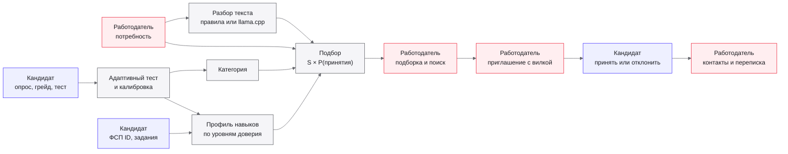
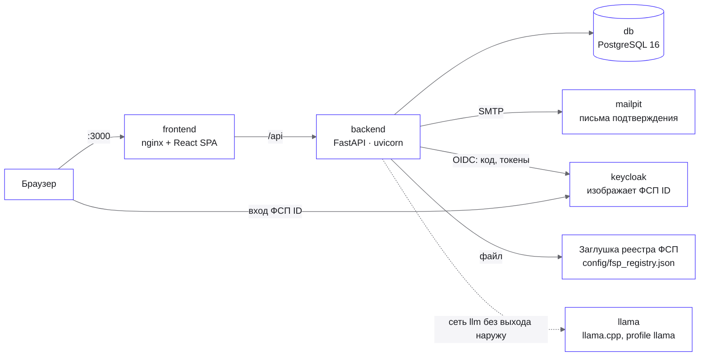

# Архитектура

Как устроен calibr: что делает каждая роль, из каких частей собран стенд, как слои бэкенда
отделяют механики от инфраструктуры и куда класть новый код. Формулы механик —
[mechanics.md](mechanics.md), правило слоёв — [ADR 0001](adr/0001-layers-and-ports.md).

## Функциональная архитектура



Синим — действия кандидата, красным — работодателя, серым — механики платформы.

| Роль | Что делает | Где проверяется |
|---|---|---|
| Кандидат | проходит путь к категории, заполняет профиль, отвечает на приглашения, откликается на вакансии, решает задания | разделы `/api/candidate/*`, кандидат видит только свои записи |
| Работодатель | описывает компанию и потребности, строит подборки, ищет по банку, приглашает, публикует вакансии и задания | разделы `/api/employer/*`, контакты кандидата — только после принятия или отклика |
| Платформа | считает уровень, категорию, профиль, скор и P(принятия), калибрует банк заданий | сценарии `app/usecase`, чистые функции `app/domain` |

Права проверяет бэкенд: чужая роль получает 403 на весь раздел, чужая запись — 404, данные
кандидата до раскрытия отдаются обезличенной проекцией на каждом эндпоинте, который их отдаёт.

## Компоненты



| Контейнер | Образ | Роль |
|---|---|---|
| `frontend` | `node:22-alpine` → `nginx:1.27-alpine` | сборка SPA и раздача статики, прокси `/api` на бэкенд |
| `backend` | `python:3.12-slim` | API, сценарии, механики; при старте — миграции и синхронизация справочника |
| `db` | `postgres:16-alpine` | все данные: учётки, путь кандидата, калибровка, профили, подборки, приглашения |
| `mailpit` | `axllent/mailpit:v1.27` | ловит письма подтверждения адреса |
| `keycloak` | `quay.io/keycloak/keycloak:26.4.0` | realm `fsp-id` с синтетическими участниками, вход по OIDC |
| `llama` | `ghcr.io/ggml-org/llama.cpp:server` | необязательная локальная модель разбора текста, во внутренней сети |
| `tests` | `python:3.12-slim`, стадия `test` | весь набор тестов бэкенда против временной базы |

Сессия — подписанный JWT в httpOnly-cookie, пароль — хэш argon2, токен подтверждения адреса
хранится хэшем. Бэкенд без состояния в памяти: попытка теста восстанавливается пересчётом из
сохранённых предъявлений, поэтому его можно перезапускать и масштабировать горизонтально.

## Бэкенд: слои и порты

```
backend/
  main.py                сборка прода: create_app (uvicorn --factory main:create_app) и sync_catalog
  composition.py         общая проводка сценариев из портов — для прода и стенда валидации
  settings.py            настройки окружения Settings и параметры механик Mechanics
  fsp_stub.py            генератор заглушки ФСП: realm Keycloak и реестр достижений из одного seed
  seed_demo.py           демо-засев стенда через прод-сценарии
  bank_report.py         отчёт покрытия банка заданий и документ матрицы грейдов
  validation/            стенд валидации: своя сборка, синтетика, команды
  app/
    domain/              сущности и правила без библиотек: тест, категория, профиль навыков,
                         подборка, учётки, справочники; банк семейств заданий — domain/bank/
    usecase/             сценарии на единице работы и порты (interface.py)
    controller/          роутеры FastAPI, схемы Pydantic, зависимости, guard ролей
    adapter/             реализации портов: IRT, выбор задания, калибровка, модель принятия,
                         почта, PDF, пароли, токен входа, ФСП ID, реестр ФСП, разбор текста
    repository/          хранилища на PostgreSQL, ORM всех таблиц (orm/), in-memory (memory/)
  config/
    mechanics.yaml       параметры механик — те же имена, что в docs/parameters.md
    catalog.yaml         справочники: грейды, сферы, специализации, темы, технологии, дисциплины ФСП
    grade_matrix.yaml    матрица «тема × грейд» — наблюдаемые умения каждой ячейки
    synonyms.yaml        словарь синонимов для разбора потребности и резюме
    fsp_registry.json    заглушка реестра ФСП — генерирует fsp_stub.py
  migrations/            миграции схемы Alembic
  tests/                 тесты через HTTP API и сценарии на in-memory хранилищах
```

Зависимости слоёв идут только внутрь, к `domain`; `tests/test_layers.py` проверяет это разбором
импортов. Сборка — вручную, без DI-контейнера, в двух точках: прод — `backend/main.py`, стенд
валидации — `backend/validation/main.py`. Обе отдают реализации портов общей проводке
`composition.py`, поэтому стенд прогоняет ровно те сценарии, что и HTTP, только на in-memory
хранилищах и симулированных часах.

Порт заводится на всё, что можно заменить другой реализацией, даже если она сейчас одна:

| Порт | Реализации | Что можно заменить |
|---|---|---|
| `SkillModel` | `adapter/irt.py` — IRT 2PL, приближение Лапласа | модель навыка |
| `ItemSelector` | `MaxInformationSelector` | правило выбора задания |
| `Calibration` | `EloCalibration` | калибровку семейств |
| `AcceptanceModel` | `CatBoostAcceptanceModel`; `NoAcceptanceModel` — без файла модели | модель принятия |
| `TextUnderstanding` | `RulesTextUnderstanding`; `ModelTextUnderstanding` с откатом на правила | разбор потребности и резюме |
| `ResumeText` | `PypdfResumeText` — только видимый текст PDF | извлечение текста резюме |
| `FspIdProvider` | `OidcFspId` (Keycloak); `MemoryFspId` в тестах | провайдер ФСП ID |
| `FspRegistry` | `FileFspRegistry` (JSON); `MemoryFspRegistry` в тестах | реестр достижений ФСП |
| `Mailer`, `MailTemplates` | `SmtpMailer`, `BrandMailTemplates`; `MemoryMailer` в тестах | почту и вид писем |
| `ProfilePdfRenderer` | `FpdfProfileRenderer` | PDF-профиль |
| `PasswordHasher`, `SessionTokens` | `Argon2Passwords`, `JwtSessions` | хэш паролей и токен сессии |
| `Clock`, `SeedSource` | системные, замороженные и симулированные | время и случайность |
| Хранилища | `Sql*` на PostgreSQL и `Memory*` для стенда | хранение |
| `CodeRunner` | `InProcessCodeRunner` — в `domain/bank/runner.py` | исполнение кода генераторов банка |

Механика — чистые функции: оценка уровня — функция от априорного, упорядоченных наблюдений и
момента запроса, без базы и состояния. Это даёт восстановление попытки пересчётом, детерминизм
стенда валидации и юнит-тесты свойств: больше верных ответов — выше уровень, больше заданий —
меньше погрешность.

## Данные

18 миграций одной цепочкой. Таблицы по сущностям:

| Сущность | Таблицы |
|---|---|
| Учётки | `users`, `email_verification_tokens` |
| Справочник | `grades`, `industries`, `specializations`, `topics`, `technologies`, `fsp_disciplines` |
| Путь кандидата | `surveys`, `test_attempts`, `presentations`, `candidate_categories`, `category_changes` |
| Калибровка | `family_calibrations`, `scale_links` |
| Профили | `candidate_profiles`, `skill_profiles`, `skill_profile_topics` |
| Компания и подбор | `companies`, `needs`, `need_topic_importances`, `selections`, `selection_entries` |
| ФСП | `fsp_snapshots`, `fsp_achievements` |
| Регулярные задания | `regular_tasks`, `regular_task_topics`, `regular_task_answers` |
| Выход на контакт | `invitations`, `invitation_messages`, `vacancies`, `applications` |

Предъявление задания хранится целиком: семейство, seed и параметры экземпляра, ответ, верность,
время ответа по часам сервера, оценка темы до ответа. На этих записях стоят калибровка,
восстановление попытки и валидация. Подборка хранится снимком потребности и выдачи со скорами и
вкладами: она открывается позже с той же выдачей, даже если потребность удалена. Статус
«истекло» у приглашения не хранится, а выводится доменом при чтении.

Справочники — данные в `config/catalog.yaml`, не в коде: 5 специализаций, 31 тема, 4 грейда,
технологии стека со связью «технология → темы», сферы бизнеса и дисциплины ФСП. Бэкенд при
старте синхронизирует их с базой; коды стабильны, на них ссылаются тест, профиль и подбор.
Новая специализация добавляется данными и семействами заданий.

## Фронтенд

React 19 и TypeScript на Vite, раскладка по слоям с импортами только вниз:

```
frontend/src/
  app/         роутер, провайдеры, оболочка кабинета, гарды ролей
  pages/       экран на маршрут: путь кандидата, тест, подборка, приглашения и остальные
  features/    сценарии экрана: сессия теста, мастер потребности, доска подборки, приглашение
  entities/    запросы к API и представления сущностей: мера уровня, подборка, приглашение
  shared/      api, i18n, ui, motion, styles, theme
```

| Часть | Как сделано |
|---|---|
| API | клиент `openapi-fetch` на типах, сгенерированных из OpenAPI бэкенда; ответы — TanStack Query |
| Тексты | словари RU и EN в `shared/i18n/locales`, 23 раздела; кириллица вне словарей запрещена проверкой |
| Стили | CSS Modules и токены двух тем в цветах брендбука ФСП; шрифты Onest и JetBrains Mono |
| Элементы управления | свои примитивы в `shared/ui`: поля, выбор, диалоги, меню, вкладки, прокрутка |
| Движение | своя библиотека `shared/motion` на CSS-токенах, WAAPI и View Transitions, с учётом `prefers-reduced-motion` |
| Проверки | 29 правил проекта в `scripts/checks`, Biome, юнит-тесты Vitest, e2e Playwright и axe |

Вёрстка адаптивна от 375 до 1920 пикселей, интерфейс работает в светлой и тёмной теме и
переключается между русским и английским без перезагрузки. PDF-профиль и письма собираются на
бэкенде из тех же токенов и шрифтов, на языке пользователя.

## Образцы

- **Новая сущность** — по слоям, файлы под одним именем:
  1. `app/domain/<имя>.py` — dataclass-ы и правила без SQLAlchemy, Pydantic и FastAPI;
  2. `app/usecase/<имя>.py` — сценарий-класс на единице работы, каждый вызов — блок
     `with uow:`; хранилище — порт-`Protocol` в `app/usecase/interface.py`;
  3. `app/repository/<имя>.py` — реализация порта, ORM таблицы — `app/repository/orm/<имя>.py`
     и импорт в `app/repository/orm/__init__.py` (по нему миграции видят таблицы); наружу —
     доменные значения, не строки ORM;
  4. `app/controller/<имя>.py` и `<имя>_schemas.py` — роутер и схемы; сценарий приходит
     зависимостью из `app/controller/deps.py`;
  5. проводка — фабрика сценария в `backend/composition.py`, реализации — в `create_app`
     (`backend/main.py`), там же подключается роутер.

  Сущность проходит все слои под одним именем: учётки — `domain/account.py`,
  `usecase/account.py`, `controller/auth.py`, `repository/account.py`; потребность — `need.py` в
  каждом слое; путь кандидата к категории — `domain/attempt.py`, `usecase/attempt.py`,
  `controller/path.py`, `repository/attempt.py`; подборка — `selection.py`, P(принятия) — за
  портом `AcceptanceModel`; регулярные задания — `regular_task.py` в каждом слое, свежесть
  профиля — `ProfileFreshness` в `usecase/skill_profile.py`; приглашение — `invitation.py` в
  каждом слое.
- **Миграция** — `uv run alembic revision --autogenerate -m "short english slug"`, затем
  прочитать и поправить. Тест `test_models_match_migrations` падает, если модели разошлись с
  миграциями. Если после слияния веток у миграций две головы — `uv run alembic merge heads`.
- **Подключение к базе** — движок только через `create_db_engine`
  (`app/repository/database.py`): время из базы приходит в UTC при любом часовом поясе
  сервера. Временная база тестов — в `Europe/Moscow`, поэтому время, зависящее от пояса базы,
  роняет тесты.
- **Справочники** — данные в `backend/config/catalog.yaml`, не в коде. Бэкенд при старте
  синхронизирует их с базой (`sync_catalog` в `backend/main.py`); коды стабильны.
- **Параметры механик** — числа из [parameters.md](parameters.md) под теми же именами в
  `config/mechanics.yaml` и полях `Mechanics` (`backend/settings.py`); в эндпоинт приходят через
  `MechanicsDep`. Константами в коде не пишутся. Новый параметр или значение — в доке и конфиге
  одним изменением: `test_mechanics_config.py` сверяет их.
- **Ошибки** — подкласс `DomainError` в `app/domain/errors.py` с `code` и `message`
  по-русски, без HTTP-статуса. Статус — строка в `STATUS` (`app/controller/errors.py`);
  эндпоинт перечисляет ошибки в `responses=error_responses(...)`, и коды попадают в OpenAPI.
- **Разделы роли** — роутер с префиксом `/api/candidate` или `/api/employer`,
  `dependencies=role_guard(Role.…)` и `responses=ROLE_RESPONSES` (см.
  `app/controller/cabinets.py`).
- **Порт внешней системы** — по образцу почты:
  1. порт — `Protocol` в `app/usecase/interface.py` (`Mailer`); на входе и выходе только типы из
     `app/domain` (`Mail` в `app/domain/mail.py`), без ORM, Pydantic и типов библиотеки;
  2. реализация — в `app/adapter/` (`SmtpMailer` в `app/adapter/mail.py`); библиотеку и протокол
     системы импортирует только она — `test_layers.py` это проверяет для SMTP и fpdf2;
  3. сборка — в `create_app` (`backend/main.py`): адаптер создаётся там и передаётся в
     проводку `composition.py`, она отдаёт его сценарию (`Accounts` шлёт письмо подтверждения);
  4. тестовая реализация — тоже в `app/adapter/` (`MemoryMailer`); тесты подставляют её через
     параметр `create_app`, хелперы поверх — в `tests/conftest.py` (`Outbox`).
- **Тест** — через HTTP API, фикстуры из `tests/conftest.py`: `client` — аноним,
  `signed_in(Role.candidate)` — вошедший пользователь роли, `outbox` — отправленные письма,
  `fsp_id` — ФСП ID в памяти (код за участника — `issue`), `fsp_registry` — реестр ФСП в памяти.
- **Типы API на фронте** генерируются из OpenAPI: при запущенном бэкенде `npm run api:types`.
