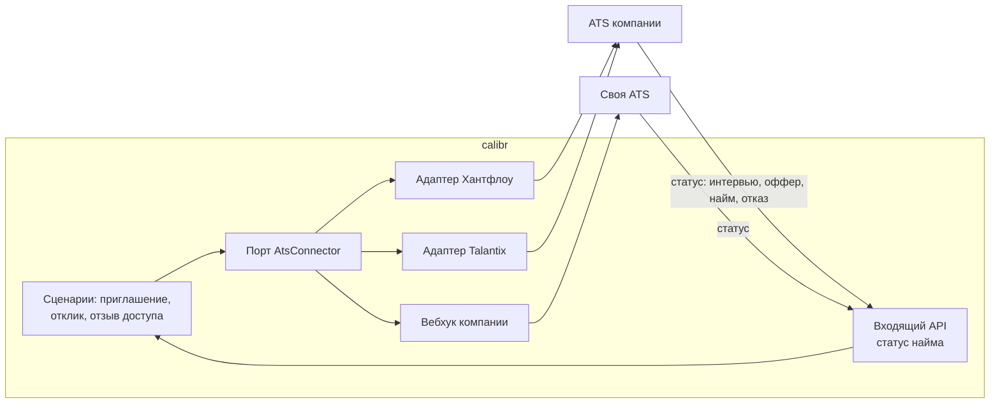

# За рамками MVP: недобросовестные работодатели и ATS

ТЗ выносит защиту от фиктивных вакансий и интеграцию с ATS за рамки MVP и ждёт концепцию и
архитектурный подход. Здесь — что из защиты уже работает, что добавляется дальше и как ATS
подключается к тем же сценариям через порты. **Ничего из раздела «дальше» не реализовано.**

## Недобросовестный работодатель

### Что уже работает

| Угроза | Что мешает уже сейчас |
|---|---|
| Сбор контактов под видом найма | обезличенная карточка до принятия; контакты — только компании, чьё приглашение принято; кандидат отзывает доступ в любой момент |
| Рассылка приглашений всем подряд | бюджет 20 приглашений в неделю на компанию; отклонённые и истёкшие в бюджет не возвращаются; одно открытое приглашение компании кандидату |
| Приманка зарплатой без цифр | вилка «от–до» обязательна в приглашении и вакансии, кандидат видит её до общения |
| Выкачивание базы через поиск | поиск отдаёт обезличенные карточки: тип результата ФСП, дисциплина и год без мероприятия и места; свободный текст скрыт |
| Подмена кандидату условий | переписка внутри приглашения хранится на платформе вместе с вилкой приглашения |

### Дальше: уровень доверия компании

Тот же принцип, что у кандидата: сигнал весит тем больше, чем труднее его подделать.

| Уровень | Сигнал | Как проверяется |
|---|---|---|
| 1 | Юрлицо подтверждено | ИНН и ОГРН по открытым данным ФНС, совпадение домена почты с сайтом компании |
| 2 | Партнёр ФСП | компания проводит или спонсирует соревнования ФСП — запись в реестре ФСП |
| 3 | История найма на платформе | доля принятых приглашений, закрытых наймом, по отметке кандидата или из ATS |
| 4 | Самоописание | профиль компании без проверки |

Сигналы недобросовестности считаются по событиям, которые платформа уже пишет:

- **Призрачные вакансии** — вакансия висит дольше срока, отклики приходят, принятых нет.
- **Пропажа после принятия** — принятое приглашение без единого сообщения компании за неделю.
- **Расхождение вилки** — кандидат после разговора отмечает, что предложенная сумма ниже вилки
  приглашения; отметка видна только платформе.
- **Массовость** — одинаковые тексты приглашений, бюджет выбирается в первый час недели.

Метка доверия компании входит в модель принятия признаком и видна кандидату рядом с
приглашением. Санкции идут ступенями: ниже недельный бюджет, вакансии ниже в общем списке,
ручная модерация при пороге. Порог и веса подбираются так же, как механики подбора: по плану,
зафиксированному до прогона, на реальных отметках — на синтетике такой признак был бы выдуман
вместе с ответом на него ([механики, §13](mechanics.md#13-взаимный-скор-и-модель-принятия)).

## Интеграция с ATS

Компания ведёт найм в своей ATS: Хантфлоу, Talantix, Potok, E-Staff или собственной. Платформа не
заменяет ATS, а поставляет в неё кандидатов, которые сами согласились на контакт, и получает
обратно исход найма.

| Направление | Событие | Что передаётся |
|---|---|---|
| В ATS | кандидат принял приглашение или откликнулся | анкета, профиль навыков с погрешностями, категория, достижения ФСП, PDF-профиль, вилка приглашения |
| В ATS | кандидат отозвал доступ | требование удалить персональные данные, полученные через платформу |
| Из ATS | статус найма изменился | этап и исход: интервью, оффер, найм, отказ с причиной из справочника |

Архитектурно это ещё один порт по [ADR 0001](adr/0001-layers-and-ports.md): `AtsConnector` в
`usecase/interface.py`, адаптер на каждую ATS в `app/adapter/`, выбор — в настройках компании.
Сценарии приглашения и отклика не меняются: они уже знают момент раскрытия и отзыва, ATS
получает данные только в нём. Вход для ATS — ключ компании с правами только на свои приглашения
и отклики.

Что даёт обратный канал:

- **Метки для модели принятия.** Сейчас она учится на синтетике; исход найма из ATS — реальная
  метка «принял и дошёл до оффера», лучше, чем «нажал принять».
- **Проверка подбора на людях.** Доля нанятых среди приглашённых из топа подборки — прямая
  метрика качества выдачи вместо синтетической эталонной релевантности.
- **История найма компании** — уровень 3 доверия к работодателю.
- **Калибровка сложности ФСП.** Связь «результат ФСП → оффер на грейд» уточняет стартовые
  экспертные сложности результатов.

Персональные данные в ATS уходят только после согласия кандидата и только компании, которой он
их раскрыл; отзыв доступа на платформе становится требованием удаления в ATS — как того требует
152-ФЗ.
