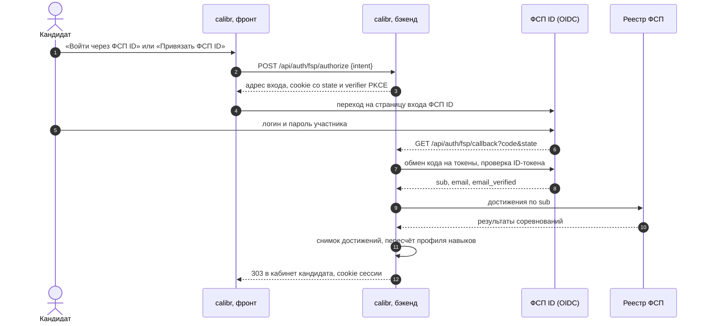

# Интеграция с ФСП

Как профиль кандидата связывается с ФСП ID, откуда берутся достижения, как они входят в профиль
навыков и что меняется при переходе на настоящий ФСП ID и реестр. Место достижений в механиках
— [mechanics.md, §11](mechanics.md#11-профиль-навыков-и-уровни-доверия).

## Две части интеграции

| Часть | Что даёт | Стандарт | На стенде | Порт |
|---|---|---|---|---|
| ФСП ID | кто этот человек: устойчивый идентификатор участника и подтверждённый email | OpenID Connect, authorization code + PKCE S256 | Keycloak 26 с realm `fsp-id` и синтетическими участниками | `FspIdProvider` |
| Реестр ФСП | что он выиграл: результаты соревнований по идентификатору | любой — за портом | JSON-заглушка `backend/config/fsp_registry.json` | `FspRegistry` |

Части разделены намеренно. ФСП ID в ТЗ назван на базе Keycloak, поэтому вход сделан чистым OIDC
без расширений Keycloak: настоящий ФСП ID подключается сменой адреса и ключей. Формат реестра ФСП
не опубликован, поэтому реестр — отдельный порт: его реализация меняется, сценарии — нет.

## Вход и привязка

| Случай | Что происходит |
|---|---|
| Новый участник входит | создаётся учётка кандидата без пароля, ФСП ID привязан, достижения в профиле |
| Участник уже привязан | вход в его учётку, снимок достижений обновляется |
| Учётка с тем же email уже есть, ФСП ID не привязан | вход отклоняется: войти по email и привязать ФСП ID в профиле — так чужой ФСП ID не захватит учётку |
| Кандидат привязывает ФСП ID из профиля | тот же протокол с `intent=link`; один ФСП ID — один кандидат |
| Email в ФСП ID не подтверждён | вход отклоняется |
| ФСП ID не отвечает | понятная ошибка, вход по email работает |

Привязка возможна только через вход в ФСП ID: ввести чужой идентификатор руками нельзя.
Отвязка убирает снимок и наблюдения ФСП из профиля.

## Данные реестра

Минимальный набор полей, который нужен механикам. Реестр отдаёт список по ФСП ID:

| Поле | Тип | Пример | Зачем |
|---|---|---|---|
| `event` | строка | «Чемпионат России по продуктовому программированию» | показ в PDF-профиле и после раскрытия |
| `date` | дата | `2026-08-08` | порядок наблюдений в профиле, год в карточке |
| `discipline` | код справочника | `algorithmic`, `product`, `security` | темы, о которых говорит результат |
| `fsp_result` | `winner`, `prize`, `finalist`, `participant` | `prize` | сложность наблюдения |
| `place` | число или пусто | `2` | показ после раскрытия |
| `team_role` | код специализации или пусто | `backend` | в командном зачёте — темы роли, а не всей команды |

Справочник дисциплин (`fsp_disciplines` в `backend/config/catalog.yaml`) сопоставляет каждой
дисциплине темы специализаций. Дисциплина без тем — например, робототехника — остаётся фактом в
профиле без наблюдения.

## Как достижение входит в профиль

- **Наблюдение высшего уровня доверия.** Результат — «решённое задание» сложности по типу
  результата: победитель — середина полосы middle, призёр — её порог, финалист — середина
  junior. Вес 1,0 против 0,7 у теста.
- **Одностороннее свидетельство.** Сильный результат поднимает оценку, если она ниже, и почти не
  влияет, если она уже выше. Участие в отборе без финала — факт, а не наблюдение: плохой день на
  соревновании говорит о навыке меньше, чем хороший.
- **Тип результата, а не уровень мероприятия.** Мероприятия и дисциплины равны, число
  соревнований входит само: каждый результат — отдельное наблюдение.
- **Грейд и категорию ФСП не меняет.** Категорию определяет только тест, поэтому кандидат без
  ФСП ничего не теряет на входе в выдачу. Без истории ФСП в профиле — нейтральная пометка, без
  штрафа.
- **Расхождение.** Если тест по теме ниже результата ФСП больше чем на порог — пометка в профиле,
  профиль считается как обычно.

## Что видит работодатель

| Где | Что показано |
|---|---|
| Подборка, объяснение | у темы — «подтверждено ФСП» |
| Обезличенная карточка | тип результата, дисциплина, год — без названия мероприятия и места: таблицы результатов публичны, и по ним человека находят по фамилии |
| После принятия приглашения или отклика, PDF-профиль | достижения полностью |
| Фильтр поиска по банку | «есть подтверждённые достижения ФСП» |

## Снимок и доступность

Достижения хранятся снимком с датой получения. Снимок обновляют привязка, каждый вход через ФСП
ID и кнопка «Обновить достижения». Профиль, подборка и карточка читают только снимок, поэтому
недоступный реестр их не ломает, а кандидат видит дату снимка.

## Переход на настоящий ФСП ID и реестр

| Что | Как |
|---|---|
| ФСП ID | `FSP_ID_ISSUER`, `FSP_ID_SERVER_URL`, `FSP_ID_CLIENT_ID`, `FSP_ID_CLIENT_SECRET` в `.env`; в ФСП ID — клиент с redirect URI `<адрес платформы>/api/auth/fsp/callback`. Код не меняется |
| Реестр | новый адаптер за портом `FspRegistry` в `backend/app/adapter/`, выбор в `backend/main.py`; сценарии, профиль и подборка не меняются |
| Справочник дисциплин | коды дисциплин реестра и их темы — в `backend/config/catalog.yaml` |
| Сложности результатов | `fsp_result_difficulty` в `backend/config/mechanics.yaml`: стартовые экспертные значения уточняются, когда у кандидатов накопятся и ФСП, и тест |

Заглушку на стенде генерирует `backend/fsp_stub.py` из одного seed: realm Keycloak
(`keycloak/realm-fsp-id.json`) и реестр (`backend/config/fsp_registry.json`) согласованы по
идентификаторам участников. Тестовые участники и что у каждого в реестре — в
[запуске](running.md#вход-через-фсп-id).
