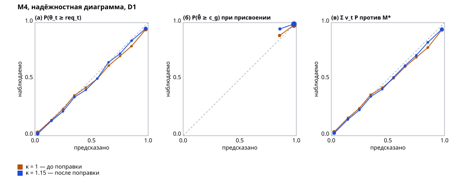
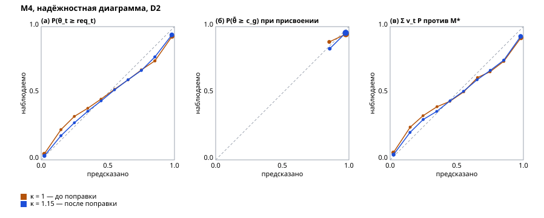

# Отчёт валидации

Отчёт собран командой стенда по [плану валидации](validation-plan.md) — правки руками не вносятся: `uv run python -m validation report` из `backend/` перезаписывает его байт в байт.

Наборы: D1 — сид 20261005, кандидатов 3000, потребностей 100, D2 — сид 20261006, кандидатов 3000, потребностей 100. Банк каждой специализации прогрет до 500 ответов на семейство на честных кандидатах набора; пар повторного прохождения на специализацию — 200; кандидатов M13 — 300. Механики — `config/mechanics.yaml`: κ = 1,15, `test_stop_sd` = 0,40, `grade_confidence` = 0,80.

Вердикт «выполнен» — выполнены все части порога метрики на наборе; «ожидает данных» — метрику этот прогон не считает. Отрицательный результат — как есть, с разбором причины.

## Сводка

| Метрика | Вердикт |
|---|---|
| [M9. Стабильность грейда](#m9-стабильность-грейда) | D1 — выполнен; D2 — выполнен |
| [M10. Совпадение грейда с истиной](#m10-совпадение-грейда-с-истиной) | D1 — выполнен; D2 — не выполнен |
| [M1. Доля релевантных в топ-10](#m1-доля-релевантных-в-топ-10) | D1 — абсолютная часть выполнена, сравнительная — ожидает данных; D2 — абсолютная часть выполнена, сравнительная — ожидает данных |
| [M2. nDCG@10](#m2-ndcg10) | D1 — абсолютная часть выполнена, сравнительная — ожидает данных; D2 — абсолютная часть не выполнена, сравнительная — ожидает данных |
| [M3. Подъём накрутчика](#m3-подъём-накрутчика) | ожидает данных |
| [M4. Калибровка вероятностей](#m4-калибровка-вероятностей) | D1 — выполнен; D2 — выполнен |
| [M5. Перекос по защищённым признакам](#m5-перекос-по-защищённым-признакам) | ожидает данных |
| [M6. Перегрев](#m6-перегрев) | ожидает данных |
| [M7. Модель принятия](#m7-модель-принятия) | D1 — выполнен; D2 — выполнен |
| [M8. Верность объяснений](#m8-верность-объяснений) | ожидает данных |
| [M11. Дискриминативность семейств](#m11-дискриминативность-семейств) | D1 — выполнен; D2 — выполнен |
| [M12. Сходимость калибровки](#m12-сходимость-калибровки) | D1 — не выполнен; D2 — не выполнен |
| [M13. Эффективность адаптивности](#m13-эффективность-адаптивности) | D1 — не выполнен; D2 — не выполнен |
| [M14. Атака утечкой](#m14-атака-утечкой) | ожидает данных |
| [M15. Детектор утечки](#m15-детектор-утечки) | ожидает данных |
| [M16. LLM-помощник](#m16-llm-помощник) | ожидает данных |
| [M17. Проверочный блок у честных](#m17-проверочный-блок-у-честных) | ожидает данных |
| [M18. Инъекции в резюме](#m18-инъекции-в-резюме) | ожидает данных |
| [M19. Сдвиг генератора](#m19-сдвиг-генератора) | не выполнен: порог M2 на D2, порог M10 на D2 |
| [M20. Согласие с людьми](#m20-согласие-с-людьми) | ожидает данных |
| [M21. Согласие семейств с моделью и разбор потребности](#m21-согласие-семейств-с-моделью-и-разбор-потребности) | D1 — выполнен (согласие семейств); разбор потребности — ожидает данных |
| [M22. Согласие попытки с моделью и разбор резюме](#m22-согласие-попытки-с-моделью-и-разбор-резюме) | ожидает данных |
| [M23. Скорость подборки](#m23-скорость-подборки) | ожидает данных |

## M9. Стабильность грейда

Определение — [план, M9](validation-plan.md#тестирование-и-категоризация). Вердикт: D1 — выполнен; D2 — выполнен.

Честные кандидаты проходят первичное определение дважды, с независимыми экземплярами и шумом ответа; пар: D1 — 1000, D2 — 1000. Категория «без категории» — тоже категория. B0 — наивный тест: общий фиксированный бланк из `test_max_items` семейств, доля верных и грейд по отсечкам доли верных (отсечка грейда — ожидаемая доля верных на его пороге по экспертным параметрам бланка); r для B0 — между долями верных. Заявленный грейд при повторе не меняется — его стабильность 1 по построению и о тесте ничего не говорит.

| Показатель | Порог | D1 | B0 D1 | D2 | B0 D2 |
|---|---|---|---|---|---|
| r(θ̄₁, θ̄₂) | ≥ 0,85 | 0,911 | 0,903 | 0,914 | 0,916 |
| Совпадение категорий | ≥ 0,65 | 0,741 | 0,636 | 0,718 | 0,644 |
| Каппа Коэна | ≥ 0,55 | 0,649 | 0,517 | 0,616 | 0,525 |
| Разница не больше грейда | ≥ 0,99 | 1,000 | 0,992 | 0,999 | 0,991 |

## M10. Совпадение грейда с истиной

Определение — [план, M10](validation-plan.md#тестирование-и-категоризация). Вердикт: D1 — выполнен; D2 — не выполнен.

Истинный грейд — полоса θ̄* = Σ w_t θ*_t; присвоенный — итог первичного определения честного кандидата набора, тест на заявленный грейд и каскад вниз. B0 — тот же наивный тест, что в M9; «заявка» — грейд, который кандидат заявил сам.

**Матрица «истинный грейд × присвоенный», D1** — честные кандидаты, 2100; на диагонали — точное совпадение.

| Истинный \ присвоенный | без категории | Стажёр | Junior | Middle | Senior | Всего |
|---|---|---|---|---|---|---|
| ниже стажёра | **208** | 29 | 0 | 0 | 0 | 237 |
| Стажёр | 76 | **411** | 6 | 0 | 0 | 493 |
| Junior | 1 | 290 | **354** | 1 | 0 | 646 |
| Middle | 0 | 3 | 285 | **184** | 0 | 472 |
| Senior | 0 | 0 | 6 | 163 | **83** | 252 |

**Матрица «истинный грейд × присвоенный», D2** — честные кандидаты, 2100; на диагонали — точное совпадение.

| Истинный \ присвоенный | без категории | Стажёр | Junior | Middle | Senior | Всего |
|---|---|---|---|---|---|---|
| ниже стажёра | **106** | 120 | 0 | 0 | 0 | 226 |
| Стажёр | 46 | **540** | 13 | 0 | 0 | 599 |
| Junior | 0 | 96 | **157** | 2 | 0 | 255 |
| Middle | 0 | 1 | 230 | **216** | 0 | 447 |
| Senior | 0 | 0 | 9 | 386 | **178** | 573 |

| Показатель | Порог | D1 | B0 D1 | Заявка D1 | D2 | B0 D2 | Заявка D2 |
|---|---|---|---|---|---|---|---|
| Завышение | ≤ 0,05 и ≤ ½ завышения B0 | 0,017 | 0,137 | 0,304 | 0,064 | 0,158 | 0,269 |
| Не дальше одного грейда | ≥ 0,98 | 0,995 | 1,000 | 0,971 | 0,995 | 0,998 | 0,974 |
| Точное совпадение | ≥ 0,55 | 0,590 | 0,730 | 0,600 | 0,570 | 0,613 | 0,650 |
| Точное среди заявивших не ниже истинного | ≥ 0,60 | 0,654 | 0,727 | 0,664 | 0,621 | 0,616 | 0,708 |
| Занижение | — | 0,392 | 0,134 | 0,097 | 0,366 | 0,229 | 0,081 |

## M1. Доля релевантных в топ-10

Определение — [план, M1](validation-plan.md#подбор). Вердикт: D1 — абсолютная часть выполнена, сравнительная — ожидает данных; D2 — абсолютная часть выполнена, сравнительная — ожидает данных.

Порог: не ниже 0,70 и не ниже лучшей из B1–B3 плюс 0,15. Сравнительная часть ждёт базовых линий B1–B3. Выдача — подборка платформы по потребности набора: точная категория по скору, затем «близкие» и нижний блок, затем остальные кандидаты пула. Пул потребности — все кандидаты набора её специализации, включая персонажей-атакующих; эталон — градация rel из истины. Потребностей в наборе: 100. B0 ранжирует весь пул по доле верных наивного теста — для ориентира, в порог не входит.

| Специализация | D1 | B0 D1 | D2 | B0 D2 |
|---|---|---|---|---|
| Бэкенд | 0,870 | 0,945 | 0,835 | 0,950 |
| Фронтенд | 0,920 | 0,935 | 0,815 | 0,980 |
| Данные и ML | 0,925 | 0,950 | 0,800 | 0,990 |
| QA | 0,900 | 0,940 | 0,875 | 0,975 |
| DevOps | 0,835 | 1,000 | 0,835 | 0,950 |
| **Все потребности** | 0,890 | 0,954 | 0,832 | 0,969 |

**B0 выше нашей выдачи** на D1, D2 — отрицательный результат. Выдача сначала отсекает по категории, а категорию правило уверенности присваивает консервативно: доля честных с заниженным грейдом (M10): D1 — 0,39, D2 — 0,37. Кандидат, чей истинный уровень выше требования, но категория ниже грейда потребности, попадает в «близкие» под всех точных, а B0 ставит его по доле верных без отсечения. Похоже, это цена отсечения по категории при консервативном грейде, а не скора внутри категории; разделят вклад отсечения и скора базовые линии внутри наших категорий (план, «Пул и выдача»).

## M2. nDCG@10

Определение — [план, M2](validation-plan.md#подбор). Вердикт: D1 — абсолютная часть выполнена, сравнительная — ожидает данных; D2 — абсолютная часть не выполнена, сравнительная — ожидает данных.

Порог: не ниже 0,75 и не ниже лучшей из B1–B3 плюс 0,10. Сравнительная часть ждёт базовых линий B1–B3. Выдача — подборка платформы по потребности набора: точная категория по скору, затем «близкие» и нижний блок, затем остальные кандидаты пула. Пул потребности — все кандидаты набора её специализации, включая персонажей-атакующих; эталон — градация rel из истины. Потребностей в наборе: 100. B0 ранжирует весь пул по доле верных наивного теста — для ориентира, в порог не входит.

| Специализация | D1 | B0 D1 | D2 | B0 D2 |
|---|---|---|---|---|
| Бэкенд | 0,841 | 0,911 | 0,745 | 0,940 |
| Фронтенд | 0,817 | 0,878 | 0,688 | 0,885 |
| Данные и ML | 0,866 | 0,913 | 0,733 | 0,950 |
| QA | 0,837 | 0,940 | 0,768 | 0,957 |
| DevOps | 0,776 | 0,982 | 0,746 | 0,885 |
| **Все потребности** | 0,828 | 0,925 | 0,736 | 0,923 |

**B0 выше нашей выдачи** на D1, D2 — отрицательный результат. Выдача сначала отсекает по категории, а категорию правило уверенности присваивает консервативно: доля честных с заниженным грейдом (M10): D1 — 0,39, D2 — 0,37. Кандидат, чей истинный уровень выше требования, но категория ниже грейда потребности, попадает в «близкие» под всех точных, а B0 ставит его по доле верных без отсечения. Похоже, это цена отсечения по категории при консервативном грейде, а не скора внутри категории; разделят вклад отсечения и скора базовые линии внутри наших категорий (план, «Пул и выдача»).

## M3. Подъём накрутчика

Определение — [план, M3](validation-plan.md#подбор). Вердикт: ожидает данных.

Ожидает данных: нет базовых линий B1–B3 и двойников-накрутчиков.

## M4. Калибровка вероятностей

Определение — [план, M4](validation-plan.md#подбор). Вердикт: D1 — выполнен; D2 — выполнен.

ECE на 10 равных корзинах, порог — каждая из трёх частей не выше 0,05; вердикт — по κ из `config/mechanics.yaml` (1,15), κ = 1 — та же механика без поправки погрешности, банк прогрет заново. (а) и (в) — по профилю навыков на всей популяции набора, включая персонажей-атакующих; требования — пороги грейдов потребностей набора. Профиль стенда — только тест: ФСП в профиль на стенде не подаётся. (б) — уверенность грейда при присвоении у честных кандидатов.

| Часть | D1, κ = 1 | D1, κ = 1,15 | D2, κ = 1 | D2, κ = 1,15 |
|---|---|---|---|---|
| (а) вероятности по темам, все | 0,029 | 0,024 | 0,050 | 0,038 |
| (а) только честные, описательно | 0,003 | 0,014 | 0,031 | 0,016 |
| (б) уверенность грейда, честные | 0,007 | 0,021 | 0,025 | 0,027 |
| (в) навыковая часть скора против M* | 0,032 | 0,025 | 0,059 | 0,048 |

**Честность погрешности общего уровня.** sd(z), z = (θ̂ − θ̄*) / σ̂ на конце определения у честных кандидатов; правило подбора κ ждёт 0,9–1,1 по каждой специализации.

| Специализация | D1, κ = 1 | D1, κ = 1,15 | D2, κ = 1 | D2, κ = 1,15 |
|---|---|---|---|---|
| Бэкенд | 1,252 | 0,992 | 1,428 | 1,372 |
| Фронтенд | 1,118 | 1,077 | 1,482 | 1,231 |
| Данные и ML | 1,181 | 1,069 | 1,635 | 1,349 |
| QA | 1,118 | 0,947 | 1,437 | 1,327 |
| DevOps | 1,151 | 1,057 | 1,426 | 1,424 |

С поправкой вне 0,9–1,1: D2 Бэкенд (1,37), D2 Фронтенд (1,23), D2 Данные и ML (1,35), D2 QA (1,33), D2 DevOps (1,42). Там погрешность общего уровня остаётся заниженной (sd(z) > 1 — вероятности грейдов и тем слишком уверенные) или завышенной.

## M5. Перекос по защищённым признакам

Определение — [план, M5](validation-plan.md#подбор). Вердикт: ожидает данных.

Ожидает данных: нет двойников по защищённым признакам и базовых линий B2, B3.

## M6. Перегрев

Определение — [план, M6](validation-plan.md#подбор). Вердикт: ожидает данных.

Ожидает данных: нет рыночной симуляции приглашений.

## M7. Модель принятия

Определение — [план, M7](validation-plan.md#подбор). Вердикт: D1 — выполнен; D2 — выполнен.

Модель — CatBoost из файла `backend/app/adapter/acceptance_model.cbm`, обученная командой `uv run python -m validation acceptance` на своём сиде; базовые линии — на тех же обучающих парах. Отложенные пары — подборки по потребностям набора: top-K по S и случайные кандидаты сверх них, решения — по правилу синтетического кандидата из скрытой склонности, которой модель не видит. ECE — 10 равных корзин. Сетка монотонности — отношение середины вилки к ожиданию 0,5–2,0 шагом 0,05 и открытые приглашения 0–10 на первых 50 парах. Порог: ROC-AUC не ниже 0,75, ECE не выше 0,05, монотонность в 100 % точек.

**D1.** Пар 5000, доля принятий 0,379.

| Модель | ROC-AUC | ECE |
|---|---|---|
| CatBoost | **0,914** | **0,014** |
| Логистическая регрессия по вилке к ожиданию | 0,853 | 0,031 |
| Константа — доля принятий обучения | 0,500 | 0,018 |

Монотонность: вилка — 1500 из 1500 соседних точек сетки, загрузка — 500 из 500; всего **100,0 %**.

**D2.** Пар 5000, доля принятий 0,326.

| Модель | ROC-AUC | ECE |
|---|---|---|
| CatBoost | **0,914** | **0,015** |
| Логистическая регрессия по вилке к ожиданию | 0,866 | 0,035 |
| Константа — доля принятий обучения | 0,500 | 0,072 |

Монотонность: вилка — 1500 из 1500 соседних точек сетки, загрузка — 500 из 500; всего **100,0 %**.

## M8. Верность объяснений

Определение — [план, M8](validation-plan.md#подбор). Вердикт: ожидает данных.

Ожидает данных: нет проверки вкладов объяснений на выдачах стенда.

## M11. Дискриминативность семейств

Определение — [план, M11](validation-plan.md#тестирование-и-категоризация). Вердикт: D1 — выполнен; D2 — выполнен.

Порог: не меньше 0,90 семейств с â_f ≥ 0,5 и r_pb ≥ 0,2; якорные семейства не считаются — их параметры известны и не оцениваются. â_f — разделяющая сила после прогрева банка на честных кандидатах набора; r_pb — точечно-бисериальная корреляция верности ответа с долей верных на остальных семействах банка у честных кандидатов набора: каждый из них ответил на экземпляр каждого семейства. На синтетике метрика проверяет конвейер и банк при допущениях симулятора; на живых ответах — D8.

| Специализация | Семейств D1 | Прошли D1 | Семейств D2 | Прошли D2 |
|---|---|---|---|---|
| Бэкенд | 86 | 1,000 | 86 | 1,000 |
| Фронтенд | 61 | 1,000 | 61 | 1,000 |
| Данные и ML | 63 | 1,000 | 63 | 1,000 |
| QA | 68 | 1,000 | 68 | 1,000 |
| DevOps | 62 | 1,000 | 62 | 1,000 |
| **Все** | 340 | 1,000 | 340 | 1,000 |

**Кандидаты на замену, D1** — 0.

Нет.

**Кандидаты на замену, D2** — 0.

Нет.

## M12. Сходимость калибровки

Определение — [план, M12](validation-plan.md#тестирование-и-категоризация). Вердикт: D1 — не выполнен; D2 — не выполнен.

Порог на 200 ответах на семейство: r(b̂, b*) ≥ 0,95; RMSE не выше 0,25 и не выше половины RMSE экспертных b₀. Банк калибруется на потоке честных кандидатов набора — с угадыванием и промахами модели ответа, а не по 2PL оценки; якорные семейства не считаются.

**D1.**

| Специализация | 50: r / RMSE | 100: r / RMSE | 200: r / RMSE | 500: r / RMSE | RMSE b₀ |
|---|---|---|---|---|---|
| Бэкенд | 0,959 / 0,446 | 0,969 / 0,386 | 0,984 / 0,254 | 0,992 / 0,177 | 0,460 |
| Фронтенд | 0,964 / 0,350 | 0,956 / 0,386 | 0,981 / 0,248 | 0,988 / 0,220 | 0,464 |
| Данные и ML | 0,965 / 0,354 | 0,973 / 0,340 | 0,988 / 0,203 | 0,992 / 0,171 | 0,468 |
| QA | 0,963 / 0,458 | 0,976 / 0,303 | 0,979 / 0,273 | 0,991 / 0,181 | 0,464 |
| DevOps | 0,958 / 0,376 | 0,976 / 0,287 | 0,977 / 0,265 | 0,988 / 0,223 | 0,460 |

Разбор остатка: ошибка e = b̂ − b* против отклонения истины от эксперта d = b* − b₀. Наклон прямой e(d) около −1 — оценка осталась у экспертной b₀ (недокоррекция переоценки), около 0 — смещение от эксперта ушло; средняя ошибка — общий сдвиг шкалы; sd остатка — шум Эло вокруг прямой. Доля систематической части — 1 − sd остатка² / RMSE².

| Специализация | Ответов | RMSE | Средняя e | Наклон e(d) | sd остатка | Доля систематической |
|---|---|---|---|---|---|---|
| Бэкенд | 200 | 0,254 | 0,007 | −0,055 | 0,253 | 0,01 |
| Бэкенд | 500 | 0,177 | −0,051 | −0,082 | 0,165 | 0,13 |
| Фронтенд | 200 | 0,248 | 0,078 | −0,079 | 0,232 | 0,12 |
| Фронтенд | 500 | 0,220 | 0,106 | −0,023 | 0,193 | 0,24 |
| Данные и ML | 200 | 0,203 | 0,046 | −0,017 | 0,197 | 0,05 |
| Данные и ML | 500 | 0,171 | 0,029 | −0,024 | 0,168 | 0,03 |
| QA | 200 | 0,273 | −0,058 | −0,162 | 0,256 | 0,12 |
| QA | 500 | 0,181 | 0,011 | 0,009 | 0,181 | 0,00 |
| DevOps | 200 | 0,265 | −0,027 | −0,038 | 0,263 | 0,01 |
| DevOps | 500 | 0,223 | 0,042 | 0,004 | 0,219 | 0,04 |

Итог на 200 ответах: систематическая часть — в среднем 0,06 MSE, наклон e(d) — −0,07, средняя e — 0,01; остаток — в основном шум вокруг прямой: оценка Эло не дошла до истины по разбросу, а не по смещению.

**D2.**

| Специализация | 50: r / RMSE | 100: r / RMSE | 200: r / RMSE | 500: r / RMSE | RMSE b₀ |
|---|---|---|---|---|---|
| Бэкенд | 0,859 / 0,626 | 0,899 / 0,531 | 0,938 / 0,421 | 0,958 / 0,348 | 0,448 |
| Фронтенд | 0,941 / 0,520 | 0,954 / 0,467 | 0,977 / 0,358 | 0,990 / 0,198 | 0,420 |
| Данные и ML | 0,926 / 0,531 | 0,946 / 0,478 | 0,964 / 0,344 | 0,985 / 0,230 | 0,421 |
| QA | 0,933 / 0,430 | 0,934 / 0,427 | 0,970 / 0,287 | 0,988 / 0,181 | 0,467 |
| DevOps | 0,927 / 0,562 | 0,936 / 0,462 | 0,967 / 0,364 | 0,982 / 0,277 | 0,424 |

Разбор остатка: ошибка e = b̂ − b* против отклонения истины от эксперта d = b* − b₀. Наклон прямой e(d) около −1 — оценка осталась у экспертной b₀ (недокоррекция переоценки), около 0 — смещение от эксперта ушло; средняя ошибка — общий сдвиг шкалы; sd остатка — шум Эло вокруг прямой. Доля систематической части — 1 − sd остатка² / RMSE².

| Специализация | Ответов | RMSE | Средняя e | Наклон e(d) | sd остатка | Доля систематической |
|---|---|---|---|---|---|---|
| Бэкенд | 200 | 0,421 | 0,002 | 0,083 | 0,420 | 0,01 |
| Бэкенд | 500 | 0,348 | −0,002 | −0,027 | 0,348 | 0,00 |
| Фронтенд | 200 | 0,358 | 0,180 | 0,157 | 0,302 | 0,29 |
| Фронтенд | 500 | 0,198 | 0,092 | 0,033 | 0,175 | 0,22 |
| Данные и ML | 200 | 0,344 | 0,107 | 0,040 | 0,326 | 0,10 |
| Данные и ML | 500 | 0,230 | 0,059 | −0,056 | 0,221 | 0,08 |
| QA | 200 | 0,287 | −0,065 | 0,025 | 0,279 | 0,05 |
| QA | 500 | 0,181 | 0,040 | −0,015 | 0,176 | 0,05 |
| DevOps | 200 | 0,364 | −0,026 | −0,213 | 0,352 | 0,06 |
| DevOps | 500 | 0,277 | 0,094 | −0,102 | 0,257 | 0,14 |

Итог на 200 ответах: систематическая часть — в среднем 0,10 MSE, наклон e(d) — 0,02, средняя e — 0,04; остаток — в основном шум вокруг прямой: оценка Эло не дошла до истины по разбросу, а не по смещению.

## M13. Эффективность адаптивности

Определение — [план, M13](validation-plan.md#тестирование-и-категоризация). Вердикт: D1 — не выполнен; D2 — не выполнен.

Медиана числа заданий до σ̄ ≤ `test_stop_sd` у адаптивного теста и общего фиксированного бланка с тем же покрытием тем, на тех же кандидатах, без лимита заданий. Порог — отношение медиан на прогретом банке не выше 0,75; холодный банк — экспертные параметры, для сравнения. Доля до лимита — доля кандидатов, дошедших до порога за `test_max_items` заданий.

**D1.**

| Специализация | Холодный: адаптивный / бланк | Отношение | Прогретый: доля до лимита, адаптивный / бланк | Прогретый: адаптивный / бланк | Отношение | σ̄ на 20: адаптивный / бланк | Семейств на грейд темы |
|---|---|---|---|---|---|---|---|
| Бэкенд | 22,0 / 24,0 | 0,92 | 0,98 / 0,81 | 21,0 / 24,0 | **0,88** | 0,407 / 0,442 | 2–5 |
| Фронтенд | 23,0 / 24,0 | 0,96 | 0,90 / 0,92 | 19,0 / 20,0 | **0,95** | 0,395 / 0,410 | 2–5 |
| Данные и ML | 23,0 / 25,0 | 0,92 | 0,92 / 0,87 | 22,0 / 24,0 | **0,92** | 0,411 / 0,438 | 2–4 |
| QA | 23,0 / 24,0 | 0,96 | 0,69 / 0,83 | 27,0 / 23,0 | **1,17** | 0,436 / 0,434 | 2–5 |
| DevOps | 23,0 / 25,0 | 0,92 | 0,93 / 0,85 | 20,0 / 23,0 | **0,87** | 0,398 / 0,429 | 2–4 |

**D2.**

| Специализация | Холодный: адаптивный / бланк | Отношение | Прогретый: доля до лимита, адаптивный / бланк | Прогретый: адаптивный / бланк | Отношение | σ̄ на 20: адаптивный / бланк | Семейств на грейд темы |
|---|---|---|---|---|---|---|---|
| Бэкенд | 23,0 / 24,0 | 0,96 | 0,95 / 0,89 | 22,0 / 22,0 | **1,00** | 0,413 / 0,417 | 2–5 |
| Фронтенд | 24,0 / 25,0 | 0,96 | 0,56 / 0,72 | 30,0 / 26,0 | **1,15** | 0,460 / 0,452 | 2–5 |
| Данные и ML | 23,0 / 26,0 | 0,88 | 0,75 / 0,74 | 27,0 / 28,0 | **0,96** | 0,448 / 0,451 | 2–4 |
| QA | 23,0 / 25,0 | 0,92 | 0,84 / 0,83 | 25,0 / 25,0 | **1,00** | 0,430 / 0,437 | 2–5 |
| DevOps | 24,0 / 26,0 | 0,92 | 0,93 / 0,82 | 23,0 / 26,0 | **0,88** | 0,422 / 0,439 | 2–4 |

**Предел от размера банка.** Адаптивный выбор берёт одно из `exposure_top_k` = 2 самых информативных семейств темы под потолком показов. Когда на грейд темы приходится 2–3 семейства, выбирать почти не из чего: в окрестности текущей оценки адаптивный тест берёт те же семейства, что бланк, собранный вокруг середины шкалы, и выигрыш адаптивности ограничен сверху размером банка, а не правилом выбора.

## M14. Атака утечкой

Определение — [план, M14](validation-plan.md#защита). Вердикт: ожидает данных.

Ожидает данных: нет атаки утечкой по схемам S1–S3.

## M15. Детектор утечки

Определение — [план, M15](validation-plan.md#защита). Вердикт: ожидает данных.

Ожидает данных: нет прогона детектора утечки.

## M16. LLM-помощник

Определение — [план, M16](validation-plan.md#защита). Вердикт: ожидает данных.

Ожидает данных: нет прогона LLM-помощника и D7.

## M17. Проверочный блок у честных

Определение — [план, M17](validation-plan.md#защита). Вердикт: ожидает данных.

Ожидает данных: нет прогона проверочного блока.

## M18. Инъекции в резюме

Определение — [план, M18](validation-plan.md#защита). Вердикт: ожидает данных.

Ожидает данных: нет набора D6.

## M19. Сдвиг генератора

Определение — [план, M19](validation-plan.md#обобщение-и-согласие-с-людьми). Вердикт: не выполнен: порог M2 на D2, порог M10 на D2.

Порог: пороги метрик M1–M4, M9, M10, M14, M15 выполняются и на D2; относительная деградация nDCG@10 и точного совпадения грейда не больше 20 %. M1 и M2 на D2 — по абсолютной части порога; M3, M14 и M15 ждут данных.

| Показатель | D1 | D2 | Деградация | Выполнено |
|---|---|---|---|---|
| nDCG@10 | 0,828 | 0,736 | 0,11 | да |
| Точное совпадение грейда | 0,590 | 0,570 | 0,03 | да |
| Порог M1 на D2 |  |  |  | да |
| Порог M2 на D2 |  |  |  | нет |
| Порог M4 на D2 |  |  |  | да |
| Порог M9 на D2 |  |  |  | да |
| Порог M10 на D2 |  |  |  | нет |

## M20. Согласие с людьми

Определение — [план, M20](validation-plan.md#обобщение-и-согласие-с-людьми). Вердикт: ожидает данных.

Ожидает данных: нет ручной разметки D4 — ожидает разметки.

## M21. Согласие семейств с моделью и разбор потребности

Определение — [план, M21](validation-plan.md#тестирование-и-категоризация). Вердикт: D1 — выполнен (согласие семейств); разбор потребности — ожидает данных.

Семейство отмечено, если проверка согласия после пакетной переоценки выводит его из выдачи: переоценённая â ниже `item_fit_discrimination_min` = 0,70 или модель с потолком объясняет ответы лучше 2PL больше чем на `item_fit_ceiling_gain_max` = 1,00 нат ([mechanics.md](mechanics.md) §7); оба числа подобраны на D3 командой `fit`. Банк набора плюс испорченные семейства — только в скрытой истине: ошибка эталона — у половины экземпляров верный ответ засчитывается неверным; ответ не зависит от уровня — P(верно) = 0,5. Банк прогревается на честных кандидатах набора, переоценка — на `calibration_refit_min_responses` = 200 ответах на семейство; якоря не портятся и в доли не входят. RMSE общего уровня — у честных кандидатов набора (200 на специализацию) на замороженном банке в трёх состояниях, на одних и тех же случайных числах ответа: испорченные в выдаче; выдача, как её оставила переоценка, — проверки согласия и дрейфа, с их ложными срабатываниями; сверх того выведены все испорченные.

Результаты прежней проверки — RMSD против переоценённых (a, b) — на D1 видели до выбора новой (журнал изменений плана); новая и её числа выбраны на D3 по правилу, записанному до прогона D3.

**D1.**

| Специализация | TPR | FPR, выбор из вариантов | FPR, вычисляемый ответ | RMSE θ̄: в выдаче / после переоценки / без испорченных |
|---|---|---|---|---|
| Бэкенд | 1,00 (2 из 2) | 0,00 (0 из 2) | 0,03 (2 из 71) | 0,436 / 0,411 / 0,430 |
| Фронтенд | 1,00 (3 из 3) | — (0 из 0) | 0,05 (3 из 55) | 0,453 / 0,385 / 0,394 |
| Данные и ML | 0,67 (2 из 3) | — (0 из 0) | 0,04 (2 из 52) | 0,419 / 0,380 / 0,414 |
| QA | 0,67 (2 из 3) | — (0 из 0) | 0,08 (5 из 60) | 0,422 / 0,409 / 0,391 |
| DevOps | 0,75 (3 из 4) | — (0 из 0) | 0,02 (1 из 54) | 0,441 / 0,406 / 0,425 |

| Мера | Значение | Порог | Выполнен |
|---|---|---|---|
| TPR | 0,80 (12 из 15) | ≥ 0,80 | да |
| FPR, выбор из вариантов | 0,00 (0 из 2) | ≤ 0,05 | да |
| FPR, вычисляемый ответ | 0,04 (13 из 292) | ≤ 0,05 | да |
| RMSE θ̄, испорченные в выдаче | 0,434 | — | — |
| RMSE θ̄, выдача после переоценки | 0,398 | — | — |
| RMSE θ̄, выведены все испорченные | 0,411 | — | — |

TPR по видам порчи: ошибка эталона — 0,60 (3 из 5); ответ не зависит от уровня — 0,90 (9 из 10). Не набрали ответов на переоценку и в долях не считаются: 31 семейств из 340. Испорчено по 5 % неякорных семейств специализации, округлено до чётного, поровну двух видов, по кругу тем и грейдов.

Разбор потребности (D5) — вторая часть M21 — считается командой `parsing` и в этот отчёт не сведён.

## M22. Согласие попытки с моделью и разбор резюме

Определение — [план, M22](validation-plan.md#защита). Вердикт: ожидает данных.

Ожидает данных: нет прогона l_z попытки; разбор резюме — нет набора D6.

## M23. Скорость подборки

Определение — [план, M23](validation-plan.md#разбор-текстов-и-скорость). Вердикт: ожидает данных.

Ожидает данных: нет замера времени подборки на 1000 кандидатах.
